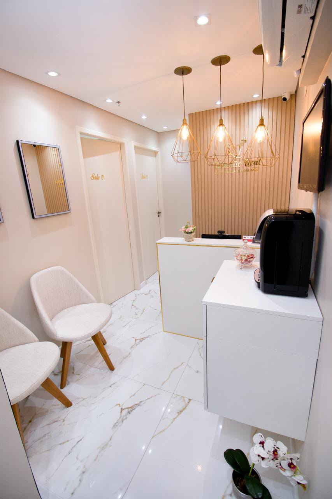
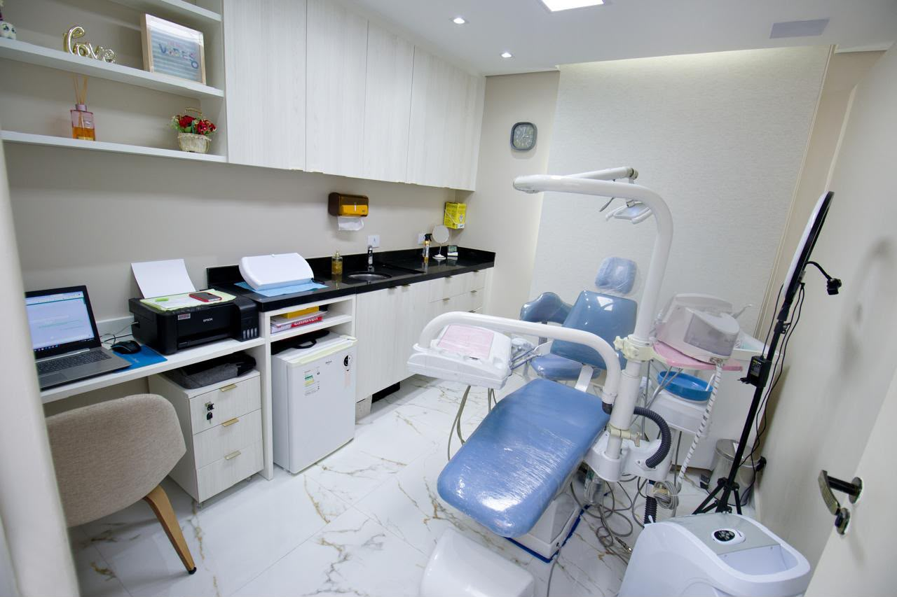
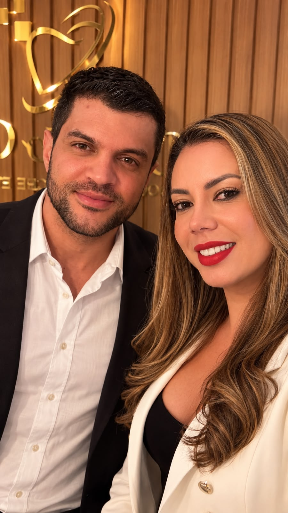
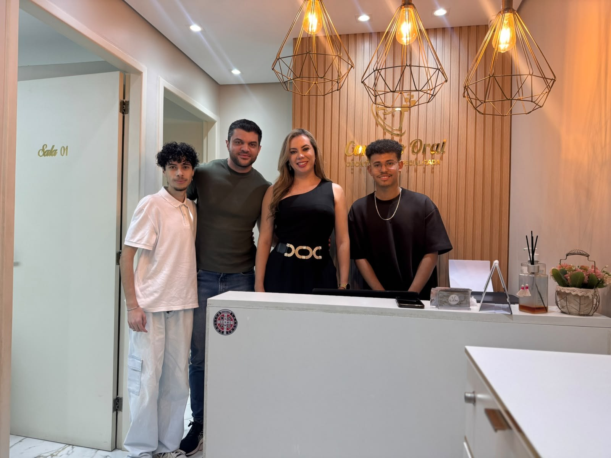
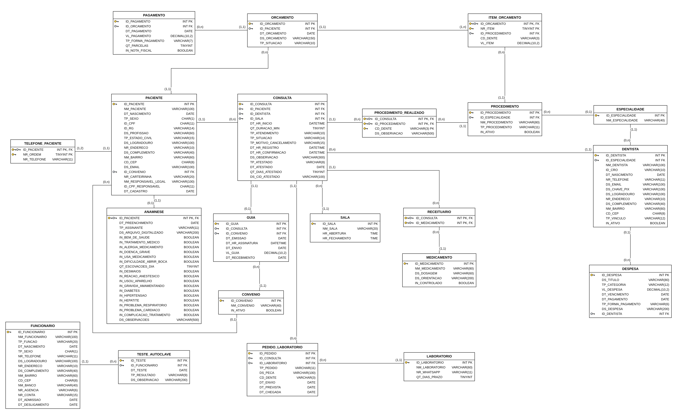

# Sistema de Gestão — Conexão Oral Odontologia Especializada

> **Entrega 2 — Modelo Lógico, Implementação SQL e Apresentação Final** · Modelagem de Dados · Prof. Cid · UNICID
>
> Banco de dados completo de uma clínica odontológica real, construído sobre o modelo conceitual da Entrega 1, revisado pela correção do professor e pelo levantamento de campo validado pela responsável em 26/10/2026.

> ⚠️ **Itens marcados [PREENCHER]** dependem de ação do grupo (foto da entrevista, usuários do GitHub, teste no MySQL do laboratório). *Remover este aviso antes da entrega.*

## Integrantes

| Nome completo do aluno | RGM | Usuário do GitHub |
|---|---|---|
| Cauã Sureira Gouveia | 48226980 | [PREENCHER] |
| Guilherme Silva Maurício | 48571971 | [PREENCHER] |
| Kaike Cardoso | 48401455 | [PREENCHER] |
| Luiz Felipe Dorneles Miranda de Oliveira | 47927879 | [PREENCHER] |
| Vitor Santos Araújo | 48394653 | [PREENCHER] |

## Arquivos da entrega

| Artefato | Arquivo |
|---|---|
| Relatório técnico | este `README.md` |
| DER conceitual revisado (notação do brModelo) | [`der/DER_conceitual.png`](der/DER_conceitual.png) (vetor: [`.svg`](der/DER_conceitual.svg)) · especificação: [`der/especificacao-der.md`](der/especificacao-der.md) |
| Modelo lógico (notação do brModelo) | [`modelo-logico/modelo_logico.png`](modelo-logico/modelo_logico.png) (vetor: [`.svg`](modelo-logico/modelo_logico.svg)) · especificação: [`modelo-logico/especificacao-modelo-logico.md`](modelo-logico/especificacao-modelo-logico.md) |
| Dicionário de dados (HTML) | [`dicionario/dicionario-de-dados.html`](dicionario/dicionario-de-dados.html) |
| Levantamento | [`levantamento/levantamento.md`](levantamento/levantamento.md) · roteiro da visita de retorno: [`levantamento/roteiro-retorno.md`](levantamento/roteiro-retorno.md) |
| Script SQL completo (estrutura, massa de dados e consultas) | [`docs/script.sql`](docs/script.sql) |
| Gerador da massa de dados | [`docs/gerador_massa.py`](docs/gerador_massa.py) |
| Evidências (fotos) | [`evidencias/`](evidencias/) |
| Slides da apresentação | [`apresentacao/`](apresentacao/) **[PREENCHER]** |

---

# 1. Relatório Técnico Final

## 1.1 Revisão do Modelo Conceitual

**Caso A** — a organização é a mesma da Entrega 1 (real, com existência comprovada).

### Caracterização da organização

**Nome e natureza.** Conexão Oral Odontologia Especializada: clínica odontológica **com fins lucrativos**, em funcionamento desde 2011, que atende pacientes particulares (80%) e de cinco convênios odontológicos (20%). Usa o sistema Simples Dental desde 2013. Uma única unidade.

| | |
|---|---|
| Endereço | R. Coelho Lisboa, 61, sala 26 — Cidade Mãe do Céu, São Paulo/SP, CEP 03323-040 |
| Contato da clínica (telefone e WhatsApp) | (11) 93148-6400 |
| Google Meu Negócio | <https://maps.app.goo.gl/yEyMq8viZV71aAuk8> |
| Instagram | <https://www.instagram.com/conexaoral> |
| Funcionamento | segunda a sexta, 8h às 18h; fecha nos feriados nacionais e no 9 de Julho |
| Responsável pela clínica | Dra. Cristiane — telefone de contato: o da clínica, (11) 93148-6400 **[PREENCHER: nome completo e, se houver, telefone direto]** |
| Quem atendeu o grupo | Guilherme Silva Maurício, sócio da clínica (sem atuação clínica) e integrante do grupo |

**Contexto e porte.** Números do levantamento (dito pelo entrevistado, validado pela responsável; os calculados pelo grupo estão indicados). São eles que dimensionam a massa de dados (seção 4).

| Item | Número |
|---|---|
| Dentistas | 7, um por especialidade (ortodontia, endodontia, implantodontia, HOF, prótese, periodontia, dentística); 6 autônomos e a proprietária, que atua em HOF |
| Outros funcionários | 1 recepcionista, 1 auxiliar de dentista, 1 auxiliar de limpeza (segundas e quartas) |
| Salas | 2, com 1 cadeira cada (Sala 01 das 14h às 18h; Sala 02 das 8h às 18h) |
| Pacientes cadastrados | 3.295 no Simples Dental; ~1.500 pacientes distintos atendidos em 12 meses |
| Atendimentos | 17 por dia útil (12 na Sala 02, 5 na Sala 01) → ~85 por semana, ~358 por mês, ~4.301 em 12 meses (calculado) |
| Por especialidade | ortodontia 65 por semana (~78%), HOF 15 por semana (~18%), endodontia 2 por semana, as outras quatro ~1 por mês cada |
| Pacientes novos | 12 a 15 por mês |
| Faltas e cancelamentos | 15 por mês, ~4% das consultas agendadas (calculado) |
| Convênio | ~72 guias por mês, em 5 convênios (Porto Seguro, Hapvida, SulAmérica, Dentalpar, MetLife) |
| Tratamento contínuo | ~270 pacientes de ortodontia em retorno mensal |
| Receitas / radiografias / peças protéticas | ~15 / ~10 / ~3 por mês (2 laboratórios, prazo de 7 dias) |
| Faturamento | ~R$ 90 mil por mês (divulgação autorizada pela responsável) |
| Valores médios | ortodontia R$ 180/mês; endodontia R$ 1.500; implante R$ 3.000/dente; prótese R$ 40.000/arcada; periodontia R$ 5.000; HOF R$ 3.000; dentística R$ 4.500 |

**Problemas e necessidades identificados.** Todos são de gestão de informação, aparecem no DER e têm consulta gerencial no script (rastreabilidade em 1.6).

| ID | Problema (situação atual) | Consequência | Como o banco resolve |
|---|---|---|---|
| P01 | Consulta confirmada verbalmente e não registrada na agenda — ainda acontece ~1 vez por semana; o sistema não mostra quem alterou um agendamento | O paciente chega, não está na agenda e é remarcado | CONSULTA com data/hora do registro e da confirmação; lista de confirmação da véspera (G01); ocorrência registrada como SEM_REGISTRO e medida (G03); log por usuário (dicionário §5) |
| P02 | Guia emitida e nem sempre assinada na hora — ~10 pendentes por mês até set/2026; **resolvido** pela regra de out/2026 (histórico) | Paciente voltava só para assinar; envio atrasava | GUIA com data/hora de assinatura, envio e recebimento; CHECK impede envio sem assinatura (RN05); G06 compara antes e depois da regra |
| P03 | Pedido, previsão e chegada das peças protéticas sem registro (hoje nenhuma atrasa; o relato da E1 foi exagerado) | Sem histórico de prazo; a prova pode ser marcada sem saber se a peça voltou | PEDIDO_LABORATORIO: cada ida ao laboratório (confecção, ajuste ou refinamento) com envio, previsão e chegada (G10, G11); auditoria da prova antes da chegada (A04) |
| P04 | Dados de saúde da Ficha de Anamnese só na imagem escaneada (o sistema não tem campos para eles) | Não dá para saber, antes da consulta, quem tem alergia, hipertensão etc. | ANAMNESE com uma coluna por pergunta da ficha, além da imagem (G12, G13) |
| P05 | Falta sem aviso registrada como "cancelado", igual ao cancelamento avisado (achado do levantamento) | A clínica acompanha cancelamentos, mas não sabe quantas são faltas | Motivo do cancelamento na CONSULTA (aviso 24h, sem confirmação, falta, sem registro) (G04, G05) |

**Escopo do sistema.** O banco reúne todos os dados da clínica, não só os setores dos problemas: pacientes, responsáveis e Ficha de Anamnese; dentistas, especialidades, funcionários e salas; agenda e atendimento; procedimentos; orçamentos e pagamentos; convênios e guias; receitas, atestados e radiografias; pedidos de peças protéticas aos laboratórios; teste da autoclave; despesas e repasse aos dentistas. **Estoque, compras e fornecedores de material ficaram fora** porque a clínica não realiza esses processos (ver "Processos prováveis não incluídos").

**Justificativa da escolha.** A clínica tem porte adequado ao projeto — sete especialidades, dois regimes de cobrança, duas salas compartilhadas, laboratórios externos — e problemas reais de registro de informação. **Vínculo declarado:** o integrante Guilherme Silva Maurício é sócio da clínica. O vínculo garantiu acesso, mas não dispensa a entrevista com a responsável no local (ver relato).

**Evidências.** Fotos no repositório (pasta [`evidencias/`](evidencias/)):

| Recepção | Consultório | Visita do grupo |
|---|---|---|
|  |  |  |
| Recepção, com o logotipo da clínica | Um dos consultórios | Visita de 18/09/2026 **[PREENCHER: quem aparece na foto]** |

### Relato da entrevista

- **Quem:** Guilherme Silva Maurício (sócio, sem atuação clínica e integrante do grupo) respondeu ao levantamento. Segundo ele, a **Dra. Cristiane, responsável pela clínica**, leu o levantamento completo e o validou em 26/10/2026, às 19h44, sem correções (validação informada por Guilherme Maurício). Integrantes presentes na conferência: **[PREENCHER]**. Como a correção da E1 apontou entrevista feita com o próprio integrante, o grupo fará a visita de retorno com a Dra. Cristiane, no local e com foto ([roteiro](levantamento/roteiro-retorno.md)) **[PREENCHER após a visita]**.
- **Quando e onde:** conferência presencial em 26/10/2026, às 16h, na própria clínica, com observação da rotina no mesmo horário.
- **Comprovação:**  **[PREENCHER: subir a foto da entrevista no local, de preferência com a Dra. Cristiane — ver [roteiro de retorno](levantamento/roteiro-retorno.md)]**
- **O que foi levantado** (texto completo em [`levantamento/levantamento.md`](levantamento/levantamento.md)): porte em números (equipe, salas, atendimentos por dia, semana e especialidade, convênios, guias, receitas, radiografias, peças, faltas, faturamento e valores médios); os quatro problemas da E1 reavaliados e um novo (P05); quem faz o quê e quem acessa o sistema; o passo a passo de 13 processos; os campos, a obrigatoriedade e a unicidade de cada cadastro do Simples Dental; as regras da E1 confirmadas e 16 regras novas; os números que o sócio e a responsável acompanham. A memória de cálculo dos atendimentos (253 dias úteis × 17 = 4.301 em 12 meses) está no levantamento.
- **Achados da observação** (separados das respostas): agendamento feito no Simples Dental, aberto no notebook da recepção; ficha de anamnese guardada no sistema como imagem; guia preenchida em papel do convênio, assinada e carimbada pela Dra., depois enviada ao site do convênio; não existe controle de estoque (poucos materiais em duas salas); o único caderno da clínica é o do teste da autoclave; as duas salas em uso ao mesmo tempo às 16h; nenhum ponto em que o processo trave ou se repita.
- **O que mudou em relação à E1:** 7 dentistas (não 8); 1 auxiliar de dentista (eram 2 até set/2026); volume real de ~358 atendimentos por mês (a E1 falava em 150 a 200 pacientes); a ficha não está "só em papel", mas os dados de saúde ficam só na imagem (P04 reformulado); P02 resolvido; P03 sem atrasos; P05 novo; entraram orçamento, procedimentos, salas, funcionários, despesas e repasse, radiografia, atestado e teste da autoclave; saíram dados de convênio e da guia que a clínica não usa.

### Processos de negócio

Os processos típicos de clínicas odontológicas foram levantados por pesquisa com apoio de IA (seção 6) e conferidos na clínica um a um.

| ID | Processo | Quem faz | O que acontece e quais dados são registrados |
|---|---|---|---|
| PR01 | Cadastro do paciente e Ficha de Anamnese | Recepcionista, paciente ou responsável | Na chegada do paciente novo, a ficha em papel é preenchida e assinada, conferida e digitada: nome, nascimento, sexo, CPF, RG, profissão, estado civil, endereço (rua, número, complemento, bairro, CEP), até dois telefones, e-mail, convênio e carteirinha (se houver), responsável legal (se menor) e as 17 respostas de saúde mais observações; a ficha escaneada é guardada e o papel, descartado |
| PR02 | Agendamento e confirmação | Recepcionista, paciente | Contato por WhatsApp ou telefone; a consulta é registrada com paciente, dentista, sala, dia, horário, duração e particular/convênio, com a data/hora do registro; na véspera, confirmação por WhatsApp (data/hora); sem confirmação até o fim do dia, cancelada e o paciente avisado |
| PR03 | Remarcação, cancelamento e falta | Recepcionista | Aviso com 24h: a consulta fica CANCELADA com o motivo e uma consulta nova é criada; falta sem aviso fica registrada como FALTA, sem cobrança |
| PR04 | Atendimento clínico | Dentista, auxiliar, Dra. responsável | Paciente paga ou assina a guia antes de entrar; após o atendimento, a Dra. registra os procedimentos (procedimento e dente); o retorno é agendado antes de o paciente sair |
| PR05 | Orçamento (plano de tratamento) | Dra. responsável | Data, descrição, situação e itens (procedimento, dente, valor); impresso e mostrado ao paciente; na ortodontia, um orçamento por mês |
| PR06 | Pagamento particular | Recepcionista | Antes da sala: valor, data, débito ou crédito (3 ou 6x sem juros), lançado no orçamento; tratamento longo pago inteiro na 1ª consulta |
| PR07 | Convênio e guia | Recepcionista, paciente, Dra. responsável | Guia emitida no sistema do convênio, assinada antes da sala, anexada ao site do convênio (data de envio) e paga no dia 30 conforme a regra do dia 15 (data de recebimento e valor) |
| PR08 | Laboratório protético | Recepcionista (com ordem da Dra.), laboratório | Cada ida da peça ao laboratório é um pedido: consulta de origem (moldagem ou prova que pediu ajuste), laboratório, tipo (confecção, ajuste ou refinamento), peça, dente, envio, previsão de 7 dias e chegada; a prova é marcada depois da chegada; cada ida gera uma despesa |
| PR09 | Receituário | Dra. (conteúdo), recepcionista (emissão) | Depois do atendimento: medicamentos escolhidos da lista (dosagem, orientação e controle vêm do medicamento); a data é a da consulta; assinada pela Dra. |
| PR10 | Atestado | Recepcionista, Dra. | Na ficha do paciente, ligado à consulta: de presença (data, hora inicial e final) ou de dias (número de dias), CID opcional; sempre em nome da Dra. *Que data e horas sejam as da consulta é suposição do grupo, a confirmar no retorno.* |
| PR11 | Radiografia | Auxiliar, recepcionista, Dra. | Registrada como procedimento da consulta (periapical ou panorâmica, com dente ou região); a imagem fica na ficha do paciente no sistema; a avaliação da Dra. fica registrada |
| PR12 | Esterilização | Auxiliar de dentista | Limpeza da sala e do material após cada atendimento; teste biológico semanal da autoclave (data, resultado, observação, quem fez) |
| PR13 | Financeiro: despesas e repasse | Sócio | Título, categoria, valor, vencimento, pagamento, forma (PIX ou boleto) e descrição; repasse ligado ao dentista (ortodontia mensal, demais no fim do tratamento, HOF sem repasse); uma despesa de laboratório por ida da peça, com o número do pedido |

**Processos prováveis não incluídos:**
- **Controle de estoque e compras de fornecedores:** a clínica não realiza. São poucos materiais em duas salas, a necessidade de comprar é vista olhando as salas e a responsável afirmou que isso não é um problema para ela. As compras entram só como despesa da categoria INSUMOS.
- **Escala fixa dos dentistas:** os dias e horários de cada um ainda não foram levantados (roteiro de retorno). A agenda real fica na CONSULTA.
- **Emissão de nota fiscal:** feita no sistema da prefeitura, fora do Simples Dental.
- **Folha de pagamento:** os salários só são lançados como despesa; não há cálculo de folha na clínica.
- **Captação e origem do paciente:** não é cadastrada e não é gestão de informação da operação.

### Requisitos

**Requisitos funcionais** (renumerados a partir da E1; a coluna E1 mostra a origem)

| ID | Requisito | Problema | E1 |
|---|---|---|---|
| RF01 | Cadastrar paciente com nome completo, data de nascimento, sexo, CPF (único), RG, profissão, estado civil, endereço (rua, número, complemento, bairro, CEP), e-mail, data de cadastro e, para paciente de convênio, o convênio e o número da carteirinha. | P04 | RF01 |
| RF02 | Registrar até dois telefones por paciente (principal e segundo). | P01 | — |
| RF03 | Registrar o nome do responsável legal do menor. | P04 | RF02 |
| RF04 | Registrar a Ficha de Anamnese com data de preenchimento, quem assinou (paciente ou responsável), caminho da ficha escaneada, as 16 perguntas de sim/não da ficha, o número de escovações por dia e as observações. | P04 | RF01 |
| RF05 | Listar os pacientes com consulta nos próximos 7 dias que têm alerta de saúde na ficha (alergia a medicamento, reação a anestésico, cardiopatia, hipertensão, diabetes, gravidez, hepatite). | P04 | — |
| RF06 | Cadastrar dentistas com nome, CRO (único), nascimento, telefone, e-mail, chave PIX, endereço, vínculo e especialidade; cadastrar as especialidades. | — | — |
| RF07 | Cadastrar funcionários com nome, função, nascimento, sexo, telefone, endereço, dados bancários, admissão e desligamento; cadastrar as salas com o horário de uso. | — | — |
| RF08 | Agendar consulta com paciente, dentista, sala, dia e horário, duração (45 a 60 min) e tipo (particular ou convênio), gravando automaticamente a data e hora do registro; recusar horários fora de seg–sex, 8h–18h. | P01 | RF03 |
| RF09 | Registrar a confirmação da véspera (data e hora) e listar as consultas do próximo dia útil ainda não confirmadas, com o telefone. | P01 | RF04 |
| RF10 | Cancelar consulta com o motivo (aviso com 24h, sem confirmação, falta, consulta não registrada) sem apagá-la, e remarcar criando uma consulta nova. | P01, P05 | — |
| RF11 | Registrar os procedimentos realizados em cada consulta (procedimento do catálogo e dente). | — | RF05 |
| RF12 | Registrar orçamento com paciente, data, descrição, situação e itens (procedimento, dente, valor), e mostrar o total, o pago e o saldo. | — | — |
| RF13 | Registrar pagamento do orçamento com data, valor, forma (débito ou crédito) e parcelas (1 no débito; 3 ou 6 no crédito). | — | RF09 |
| RF14 | Registrar a guia da consulta de convênio com emissão, data/hora da assinatura, envio, valor e recebimento (o convênio vem do cadastro do paciente); listar guias não enviadas e o valor a receber por convênio e data. | P02 | RF06–RF08 |
| RF15 | Emitir receita para consulta realizada, com os medicamentos escolhidos da lista do sistema; a data é a da consulta (mais de um medicamento por receita: a confirmar no retorno). | — | RF16 |
| RF16 | Registrar na consulta o atestado de presença (o horário é o da consulta) ou de dias (número de dias), com CID opcional. | — | — |
| RF17 | Registrar a radiografia como procedimento da consulta (tipo e dente ou região) e a avaliação da Dra.; listar as radiografias ainda sem avaliação. | — | — |
| RF18 | Registrar cada ida da peça protética ao laboratório (consulta de origem, laboratório, tipo, peça, dente, envio, previsão e chegada) e listar as peças que estão no laboratório. | P03 | RF10–RF12 |
| RF19 | Registrar o teste biológico semanal da autoclave (data, resultado, observação, quem fez). | — | — |
| RF20 | Registrar despesas (título, categoria, valor, vencimento, pagamento, forma, descrição), ligando o repasse ao dentista; listar contas em aberto. | — | — |
| RF21 | Consultar o histórico clínico de um paciente (consultas, dentistas, procedimentos e dentes). | P04 | RF13 |
| RF22 | Emitir os relatórios da seção 1.6 (confirmação, cancelamentos e faltas, guias, laboratórios, fichas, faturamento, despesas, ocupação). | todos | RF14, RF15 |

**Requisitos não funcionais**

| ID | Categoria | Requisito |
|---|---|---|
| RNF01 | Segurança/Privacidade | Dados de saúde acessíveis só aos papéis que hoje abrem a ficha (recepcionista, Dra. responsável, sócio), conforme a LGPD (dicionário §6). |
| RNF02 | Disponibilidade | Disponível de segunda a sexta, das 8h às 18h. |
| RNF03 | Usabilidade | Operável pela recepcionista sem treinamento técnico; cadastro e agendamento em uma tela cada. |
| RNF04 | Desempenho | Agenda do dia e histórico do paciente em até 2 segundos, com os índices por dentista, sala e paciente (meta proposta pelo grupo; hoje o sistema "nunca ficou lento"). |
| RNF05 | Integridade/Backup | Integridade por PK, FK e CHECK no SGBD; backup diário (hoje o próprio sistema faz o backup). |
| RNF06 | Controle de acesso | Três perfis de uso, como hoje — Recepção, Clínica e Financeiro —, mais um perfil de Auditoria só de leitura proposto pelo grupo. |
| RNF07 | Auditoria | Cada pessoa com usuário próprio no SGBD, para que o log mostre quem registrou, alterou ou cancelou cada consulta (hoje não dá para saber). |
| RNF08 | Escalabilidade | Aceitar novos dentistas, especialidades, convênios, procedimentos e salas sem mudar a estrutura. |
| RNF09 | Retenção | Histórico guardado sem prazo de exclusão, como hoje; nada clínico é apagado. |
| RNF10 | Codificação | utf8mb4 para acentuação correta em nomes e observações. |
| RNF11 | Equipamentos | Funcionar nos notebooks da recepção e da Dra. responsável. |

**Requisitos prováveis não incluídos:** *agendamento online pelo paciente* e *lembrete automático por WhatsApp* (a confirmação é feita pela recepcionista, e a clínica disse não precisar de nada além do que já tem); *integração eletrônica com os convênios (TISS)* (a guia é enviada no site de cada convênio, e não há glosa); *emissão de nota fiscal* (feita no sistema da prefeitura); *controle de estoque* (processo inexistente); *cadastro da origem do paciente* (não é usado).

### Regras de negócio

RN01–RN10 e RP01–RP04 mantêm os códigos da E1. A coluna *Como é garantida* indica a restrição do script ou a consulta de auditoria que confere a regra.

| ID | Regra | Por que importa | Como é garantida |
|---|---|---|---|
| RN01 | Paciente novo preenche e assina a Ficha de Anamnese antes do primeiro atendimento. | Sem a ficha, o dentista não sabe de alergias e medicamentos; é o respaldo da clínica. | Auditoria A01 (envolve duas tabelas) |
| RN02 | Ficha de menor é preenchida e assinada pelo responsável legal, cujo nome fica no cadastro do menor. | O menor não pode consentir sozinho. | TP_ASSINANTE registra quem assinou (CK_ANAMNESE_ASSINANTE limita a PACIENTE ou RESPONSAVEL); a auditoria A02 confere menor sem responsável ou ficha assinada por ele |
| RN03 | Uma consulta só é válida se estiver registrada no sistema. | Ataca diretamente o P01. | DT_HR_REGISTRO NOT NULL com DEFAULT; motivo SEM_REGISTRO (G03) |
| RN04 | Toda consulta tem exatamente um paciente e um dentista. | Sem isso não há histórico nem produção por dentista. | FK_CONSULTA_PACIENTE e FK_CONSULTA_DENTISTA, NOT NULL |
| RN05 | *(ajustada)* A guia é assinada antes de o paciente entrar na sala (desde out/2026) e só é enviada ao convênio depois de assinada. | Guia sem assinatura não é paga (P02). | CK_GUIA_ENVIO_ASSINADA; auditoria A03 |
| RN06 | A prova da peça só é feita depois que a peça chega do laboratório. | Evita o paciente vir à toa. | Auditoria A04 (procedimento do tipo PROVA_PECA antes da chegada) |
| RN07 | *(ajustada)* Todo paciente particular paga antes de entrar na sala; tratamento com várias consultas é pago inteiro na primeira; sem pagamento, o atendimento não anda (em vigor desde 2024). | Regra da responsável; elimina inadimplência. | Auditoria A05 |
| RN08 | Cada pedido de peça protética vai a exatamente um laboratório. | Saber de quem cobrar prazo e custo. | FK_PEDIDO_LABORATORIO NOT NULL |
| RN09 | *(reescrita)* Cada consulta é paga pelo convênio ou pelo paciente, nunca pelos dois; não existe consulta mista. | Evita cobrança em duplicidade. | TP_ATENDIMENTO (CK_CONSULTA_ATENDIMENTO), UQ_GUIA_CONSULTA; auditorias A06 (particular com guia, convênio sem guia, convênio com pagamento particular) e A14 |
| RN10 | Receita só para consulta realizada (feita depois do atendimento). | Receita sem atendimento é irregular. | Auditoria A07 |
| RN11 | Cada sala atende um paciente por vez (uma cadeira por sala) e só no seu horário (Sala 01 das 14h às 18h). *Um dentista não atender dois pacientes ao mesmo tempo é suposição do grupo, a confirmar no retorno.* | Conflito de agenda gera espera e atendimento perdido. | CK_SALA_HORARIO; auditorias A08 e A09 |
| RN12 | Cancelamento com 24h de antecedência: a consulta fica no histórico como cancelada, com o motivo, e uma nova é criada; falta sem aviso não tem cobrança. | Medir faltas (P05) e manter o histórico. | CK_CONSULTA_MOTIVO, CK_CONSULTA_MOTIVO_VALOR; nenhum DELETE de consulta; A10 |
| RN13 | A agenda do dia seguinte é confirmada na véspera; quem não confirma até o fim do dia tem a consulta cancelada e é avisado. | Libera horário para outro paciente. | CK_CONSULTA_CONFIRMACAO, CK_CONSULTA_SEM_CONFIRMACAO; G01, A10 |
| RN14 | Pagamento particular em débito ou crédito em 3 ou 6 vezes sem juros (entrada, fiado e desconto: a levantar). | Padroniza o caixa. | CK_PAGAMENTO_FORMA, CK_PAGAMENTO_PARCELAS |
| RN15 | Na ortodontia, cada mês é um orçamento novo (um por paciente por mês). | Base da cobrança mensal. | Auditoria A11 |
| RN16 | HOF é feita só pela proprietária e não gera repasse. | O valor fica todo com a clínica. | Auditoria A12 |
| RN17 | Repasse é pago por PIX e lançado como despesa ligada ao dentista: ortodontia todo mês; demais no fim do tratamento. | Controle do que cada dentista recebeu (o valor combinado não era registrado). | CK_DESPESA_REPASSE, CK_DESPESA_REPASSE_PIX |
| RN18 | Despesa tem título, valor, vencimento, categoria, forma (PIX ou boleto), descrição e data de pagamento. No banco, a data de pagamento fica vazia enquanto a conta está em aberto, para que as contas a pagar possam ser listadas (a confirmar no retorno). | Contas a pagar completas. | NOT NULL; CK_DESPESA_FORMA, CK_DESPESA_CATEGORIA |
| RN19 | Toda peça protética sai por ordem da Dra. responsável. | Controle clínico e de custo. | Regra de processo (a ordem não é registrada) |
| RN20 | Receitas e atestados de todos os dentistas são assinados pela Dra. responsável. | Responsabilidade técnica. | Regra de processo |
| RN21 | Atestado de presença tem hora inicial e final; atestado de dias tem o número de dias; CID opcional. *São suposições do grupo, a confirmar no retorno: data e horas são as da consulta, só há atestado para consulta realizada e no máximo um por consulta.* | Validade do documento. | CK_CONSULTA_ATESTADO |
| RN22 | Toda radiografia é avaliada pela Dra., e a avaliação fica registrada. | Diagnóstico documentado. | Avaliação em PROCEDIMENTO_REALIZADO.DS_OBSERVACAO (U05); auditoria A15 |
| RN23 | O teste biológico da autoclave é feito toda semana. *Registrar o resultado e exigir observação quando reprovado é proposta do grupo.* | Comprovação à vigilância sanitária. | UQ_TESTE_DATA, CK_TESTE_REPROVADO; auditoria A13 |
| RN24 | Paciente de convênio tem o convênio e o número da carteirinha; paciente particular não tem nenhum dos dois. *A carteirinha não se repetir no mesmo convênio é suposição do grupo.* | Necessário para emitir a guia. | CK_PACIENTE_CONVENIO, UQ_PACIENTE_CARTEIRINHA |
| RN25 | CPF do paciente e CRO do dentista não se repetem. | Evita cadastro duplicado. | UQ_PACIENTE_CPF, UQ_DENTISTA_CRO |
| RN26 | O prazo padrão do laboratório é de 7 dias. | Base da previsão de chegada da peça. | DEFAULT 7 em QT_DIAS_PRAZO; CK_LABORATORIO_PRAZO |

| ID | Restrição/política | Onde aparece |
|---|---|---|
| RP01 | Funcionamento de segunda a sexta, das 8h às 18h; fechado nos feriados nacionais e no 9 de Julho. | CK_CONSULTA_DIA_UTIL, CK_CONSULTA_HORARIO, CK_SALA_HORARIO; feriados em G20 |
| RP02 | *(ajustada)* Dados de saúde são sensíveis (LGPD); a ficha traz declaração assinada pelo paciente, sem termo separado; abrem a ficha a Dra., a recepcionista e o sócio. | Dicionário §5 e §6 |
| RP03 | *(ajustada)* A ficha em papel é descartada depois de escaneada; o respaldo é a cópia escaneada no cadastro. | DS_ARQUIVO_DIGITALIZADO NOT NULL |
| RP04 | *(detalhada)* Regra dos cinco convênios: guia enviada antes do dia 15 é paga no dia 30 do mesmo mês; depois, no dia 30 do mês seguinte. | G08 (valor a receber por data) |

**Regras prováveis não incluídas:** *cobrança de falta* e *limite de faltas que bloqueia o agendamento* (a clínica não cobra nem marca o paciente); *autorização prévia, carência e glosa do convênio* (guia recusada não acontece); *estoque mínimo e validade de material* (não há estoque); *garantia da peça protética* (a levantar no retorno).

### DER conceitual revisado

- **Notação:** brModelo (Heuser) — atributos como círculos (identificador preenchido), compostos como elipse com sub-atributos, atributo opcional com (0,1), entidade fraca identificada pelo relacionamento com linha grossa, entidade associativa como retângulo em volta do losango. Diagrama feito com apoio de IA (seção 6, Uso 3).
- **Diagrama:** [`der/DER_conceitual.png`](der/DER_conceitual.png) (em vetor: [`DER_conceitual.svg`](der/DER_conceitual.svg)). A lista completa de entidades, atributos, relacionamentos e cardinalidades, cada relacionamento com o fato do levantamento que o justifica, está em [`der/especificacao-der.md`](der/especificacao-der.md).
- **Conteúdo:** 18 entidades (2 fracas: ANAMNESE e ITEM_ORCAMENTO), 1 entidade associativa (PROCEDIMENTO_REALIZADO) e **17 relacionamentos**, todos binários, com (mín, máx) nos dois lados: 2 identificadores, 1 N:N (CONSULTA *receita* MEDICAMENTO), nenhum autorrelacionamento. Atributos compostos ENDERECO, DADOS_BANCARIOS, AVALIACAO_SAUDE, HISTORICO_SAUDE e ATESTADO (0,1); multivalorado TELEFONE (1,2); atributo de relacionamento NR_CARTEIRINHA. Sem chaves estrangeiras e sem generalização.


- **Por que o DER encolheu (35 → 26 → 17 relacionamentos).** O rascunho feito antes da entrevista tinha 35 relacionamentos e entidades sem base na clínica (estoque, compras, fornecedores, tabela de preço por convênio, disponibilidade semanal). A 1ª versão a partir do levantamento ainda tinha 26, porque modelava como entidade o que, na clínica, é só um dado de outra coisa. O critério final foi: **só é entidade o que tem dados próprios e é consultado por conta própria; só é relacionamento o que a clínica registra ou o que uma regra precisa conferir.** Saíram: o autorrelacionamento do responsável legal (o grupo guarda só o nome dele, que é o que a ficha pede), a ligação consulta–orçamento (o pagamento é lançado no orçamento, não na consulta), a ligação guia–convênio (o convênio vem do paciente), a receita como entidade (virou o N:N consulta–medicamento, porque não tem número nem dado próprio), o atestado como entidade (virou atributo composto opcional da consulta), a radiografia como entidade (é um procedimento da consulta) e o par peça + envio, com cinco relacionamentos, que virou PEDIDO_LABORATORIO, com dois. A tabela "saiu → virou → por quê" está na [especificação](der/especificacao-der.md#o-que-mudou-de-35-para-26-e-agora-para-17-relacionamentos).

### Revisão a partir da correção da E1 (Caso A)

| Apontamento da correção da E1 | O que mudou no trabalho | Por quê |
|---|---|---|
| Link do repositório enviado errado (nota zerada) | Repositório novo para a E2; link conferido antes do envio **[PREENCHER: conferir]** | Só é corrigido o que está na branch main do link enviado |
| Integrante sem nome completo | Tabela de Integrantes com nome completo, RGM e usuário do GitHub | Exigência do esqueleto |
| Caracterização sem volume de atividades nem total de pessoas | Tabela de porte com números do levantamento validado e memória de cálculo | Os números justificam a massa de dados |
| Sem seção de evidências no README | Fotos exibidas no README, com legenda, e arquivos na pasta `evidencias/` | A evidência precisa estar visível e no repositório |
| Entrevista feita com o próprio integrante | Levantamento validado pela responsável (Dra. Cristiane); nova conversa com ela, no local e com foto, prevista no roteiro de retorno **[PREENCHER após a visita]** | O vínculo não dispensa a entrevista com a responsável |
| Processos com cobertura de 50% | 13 processos (PR01–PR13), incluindo cancelamento, orçamento, pagamento, convênio, atestado, radiografia, esterilização e financeiro, e justificativa dos não incluídos | O banco deve cobrir toda a organização |
| Regras com cobertura de 58% e sem explicar por que importam | RN11–RN26 novas e RP01–RP04 detalhadas, com as colunas "Por que importa" e "Como é garantida" | Pedido da correção |
| Faltavam procedimentos, especialidades e orçamento | Catálogos PROCEDIMENTO e ESPECIALIDADE; ORCAMENTO + ITEM_ORCAMENTO + PAGAMENTO; PROCEDIMENTO_REALIZADO por consulta e dente | Uma consulta tem vários procedimentos; o valor fica no orçamento, como na clínica |
| `procedimento` como texto livre em CONSULTA | Entidade associativa PROCEDIMENTO_REALIZADO (consulta, procedimento, dente) | Atomicidade (1FN) e catálogo pesquisável |
| Especialidade como atributo de DENTISTA | Entidade ESPECIALIDADE, relacionamento 1:N com DENTISTA e com PROCEDIMENTO | O levantamento confirmou uma especialidade por dentista; a entidade evita grafias diferentes e permite o faturamento por especialidade |
| Faltava anamnese; `historico_saude` multivalorado nem aparecia no DER | ANAMNESE (1:1 com PACIENTE) com uma coluna por pergunta da ficha real | `historico_saude` era um grupo de 17 perguntas diferentes, não um valor repetido (1FN) |
| Faltavam contas a pagar | DESPESA, com repasse ligado ao dentista e categoria fechada para cada tipo de conta (inclusive laboratório) | Processo real do sócio, lançado todos os dias |
| Faltava esterilização | TESTE_AUTOCLAVE (teste biológico semanal) | É o único registro de esterilização que a clínica faz |
| Faltavam estoque e compras (sugestão MATERIAL/ESTOQUE/FORNECEDOR) | **Não incluídos — o grupo discorda, com base no levantamento validado** | A clínica não controla estoque nem compras (nem no sistema, nem no papel) e disse que não faz sentido para ela; as compras entram como despesa da categoria INSUMOS |
| Sugestão FUNCIONARIO/USUARIO | FUNCIONARIO com os campos do sistema; o usuário de acesso é tratado no SGBD (dicionário §5 e §6) | Só três pessoas usam o sistema; um usuário por pessoa no SGBD resolve a autoria |
| PACIENTE sem RG, profissão, estado civil, histórico e data de cadastro | Todos os campos da ficha estão em PACIENTE; o histórico de saúde está em ANAMNESE | Consistência entre DER e dicionário |
| Atributos sem prefixo (nome, cpf, data) | Convenção de prefixos (NM_, DT_, ID_, CD_, QT_, TP_, IN_, DS_, VL_, NR_, HR_) | Padrão do dicionário de referência |
| DER com chaves estrangeiras desenhadas | Removidas; FKs só no modelo lógico | FK é decisão do modelo lógico |
| DER sem cardinalidade mínima | (mín, máx) nos dois lados de todos os relacionamentos | Notação exigida |
| *(avaliação do grupo)* Rascunho da E2 com relacionamentos exagerados | DER refeito duas vezes: 35 → 26 → 17 relacionamentos, cada um com o fato do levantamento que o justifica | Modelo menor, mas fiel ao que a clínica faz e registra |
| Dicionário em HTML com 3 de 9 entidades e sem os itens do modelo | Dicionário HTML completo (21 tabelas) no formato 02-03g, com as 6 seções | Pedido da correção |
| Uso de IA com prompts só descritos | Prompts transcritos na seção 6 | Pedido da correção |
| README com formato copiado de outro grupo | README segue o esqueleto do professor seção por seção | Autoria própria |
| Pasta `fluxogramas/` com imagens não usadas; ficha de anamnese em .docx | Não foram trazidas; os campos da ficha estão no modelo e no levantamento | Arquivos sem uso confundem a correção |

**Decisões da E1 mantidas:** CONSULTA única para agendamento e atendimento (17.1 da E1); GUIA e PAGAMENTO separados (17.2); CONVENIO e LABORATORIO como entidades (17.4).

## 1.2 Conversão do Modelo Conceitual para o Modelo Lógico

**Entidades → tabelas.** Cada uma das 18 entidades virou uma tabela com o mesmo nome. Outras três tabelas não vêm de entidades fortes ou fracas: PROCEDIMENTO_REALIZADO (entidade associativa), TELEFONE_PACIENTE (multivalorado TELEFONE (1,2)) e RECEITUARIO (relacionamento N:N *receita*). São **21 tabelas** no total.

**Orçamento e "tratamentos".** No Simples Dental, um orçamento tem vários tratamentos e cada tratamento tem vários procedimentos. O modelo vai direto de ORCAMENTO para ITEM_ORCAMENTO (um procedimento por item, com dente e valor) porque, nas palavras do levantamento, "procedimento e tratamento são a mesma coisa para a clínica"; um nível a mais não guardaria nenhum dado novo.

**Atributos → colunas.** Atributos simples viraram colunas com tipo físico (dicionário). Os compostos foram decompostos:

- ENDERECO em DS_LOGRADOURO, NR_ENDERECO, DS_COMPLEMENTO, NM_BAIRRO e CD_CEP;
- DADOS_BANCARIOS em NM_BANCO, NR_AGENCIA e NR_CONTA;
- AVALIACAO_SAUDE e HISTORICO_SAUDE em uma coluna por pergunta;
- o composto opcional ATESTADO (0,1) da CONSULTA em TP_ATESTADO, QT_DIAS_ATESTADO e DS_CID_ATESTADO. As três colunas aceitam nulo (consulta sem atestado), e um CHECK exige que estejam todas vazias ou coerentes com o tipo.

O multivalorado TELEFONE (1,2) virou tabela própria (1FN), com NR_ORDEM limitado a 1 e 2. O atributo de relacionamento NR_CARTEIRINHA foi para PACIENTE, junto com a FK de R03. Os identificadores viraram PK.

**Atributos derivados não viraram colunas:**

- idade (de DT_NASCIMENTO);
- valor total e saldo do orçamento (dos itens e dos pagamentos);
- data e tipo da receita (da consulta e do medicamento);
- data e horário do atestado de presença (os da consulta — suposição do grupo, a confirmar no retorno);
- atraso da peça (DT_PREVISTA x DT_CHEGADA);
- data prevista de pagamento do convênio (regra RP04).

**Relacionamentos → chaves.** Em 1:N, a PK do lado 1 virou FK no lado N (ex.: ID_PACIENTE em CONSULTA). A FK é NOT NULL quando a participação do lado 1 é obrigatória — (1,1). Aceita nulo quando é (0,1):

- ID_CONVENIO em PACIENTE (paciente particular);
- ID_ESPECIALIDADE em PROCEDIMENTO (só a radiografia não tem);
- ID_DENTISTA em DESPESA (só o repasse tem).

**Cardinalidades.**
- **1:1** — PACIENTE–ANAMNESE: a PK de ANAMNESE é a própria FK ID_PACIENTE (entidade fraca; separar a ficha em tabela própria restringe o acesso aos dados de saúde). CONSULTA–GUIA: FK ID_CONSULTA em GUIA com UNIQUE.
- **1:N** — 15 ligações, sempre com a FK no lado N, entre elas CONSULTA → PACIENTE, DENTISTA e SALA, e PEDIDO_LABORATORIO → CONSULTA e LABORATORIO. Lista completa, com a cardinalidade de cada ponta, em [`especificacao-modelo-logico.md`](modelo-logico/especificacao-modelo-logico.md).
- **Entidade fraca** — ITEM_ORCAMENTO recebe a PK do orçamento como parte da sua: PK ID_ORCAMENTO + NR_ITEM.
- **N:N** — CONSULTA x MEDICAMENTO (*receita*) virou RECEITUARIO, com PK composta pelas duas FKs e nenhuma outra coluna. CONSULTA x PROCEDIMENTO (*realiza*) virou PROCEDIMENTO_REALIZADO, com PK (ID_CONSULTA, ID_PROCEDIMENTO, CD_DENTE): o mesmo procedimento pode ser feito em vários dentes na mesma consulta, então o par sozinho não identifica a linha.

**Generalização/especialização.** O DER revisado **não tem**. O rascunho anterior tinha COLABORADOR → DENTISTA e FORNECEDOR → LABORATORIO. Foram desfeitas por três motivos:

- dentista e funcionário são cadastros diferentes no sistema, com campos diferentes (CRO, chave PIX e especialidade de um lado; função, admissão e dados bancários do outro) e nenhum campo único em comum;
- nenhuma tabela precisa apontar para "qualquer pessoa da clínica": quem agenda e quem recebe pagamentos não é registrado (a autoria fica no log do SGBD);
- não existem fornecedores de material no escopo, então LABORATORIO não especializa nada.

**O que deixou de ser tabela nesta revisão, e o custo de cada escolha.** A primeira versão do lógico tinha 25 tabelas. Quatro saíram porque guardavam dados que estão em outra tabela ou que o grupo decidiu não guardar (o custo está na última coluna):

| Era | Ficou | Custo consciente (e o que faria voltar a ser tabela) |
|---|---|---|
| RECEITUARIO (cabeçalho) + ITEM_RECEITA | RECEITUARIO = só o N:N consulta–medicamento | Duas receitas separadas na mesma consulta não se distinguem. Volta se a clínica precisar disso (roteiro de retorno). |
| ATESTADO | 3 colunas da CONSULTA | No máximo um atestado por consulta, e a data e as horas do atestado passam a ser as da consulta (agendada), não a chegada e a saída reais. Volta a ser tabela se o retorno mostrar mais de um atestado ou horários próprios. |
| RADIOGRAFIA | Linha de PROCEDIMENTO_REALIZADO com procedimento do tipo RADIOGRAFIA; avaliação em DS_OBSERVACAO | A data da avaliação não é guardada. A imagem continua anexada à ficha do paciente no sistema, como hoje: diferente da ficha de anamnese, cujo arquivo escaneado é o respaldo assinado exigido pela RP03, a radiografia não é documento assinado, e o que a RN22 pede (a avaliação) fica no banco. |
| PECA_PROTETICA + ENVIO_PECA | PEDIDO_LABORATORIO, um por ida | Não há chave que agrupe as idas da mesma peça (descrição e dente se repetem em cada ida), nem ligação entre a prova e o pedido: a auditoria A04 liga os dois pelo paciente, pelo dentista e pela data, e pode dar alarme falso se o mesmo paciente tiver duas peças ao mesmo tempo com o mesmo dentista. O custo de cada ida é uma despesa da categoria LABORATORIO. Volta a ter duas tabelas se a clínica quiser custo e prazo por peça inteira. |

## 1.3 Definição de Chaves Primárias e Estrangeiras

| Tabela | PK | FKs (→ tabela referenciada) |
|---|---|---|
| ESPECIALIDADE | ID_ESPECIALIDADE | — |
| DENTISTA | ID_DENTISTA | ID_ESPECIALIDADE → ESPECIALIDADE |
| FUNCIONARIO | ID_FUNCIONARIO | — |
| SALA | ID_SALA | — |
| CONVENIO | ID_CONVENIO | — |
| PACIENTE | ID_PACIENTE | ID_CONVENIO → CONVENIO (aceita nulo) |
| TELEFONE_PACIENTE | ID_PACIENTE + NR_ORDEM | ID_PACIENTE → PACIENTE |
| ANAMNESE | ID_PACIENTE | ID_PACIENTE → PACIENTE |
| PROCEDIMENTO | ID_PROCEDIMENTO | ID_ESPECIALIDADE → ESPECIALIDADE (aceita nulo) |
| ORCAMENTO | ID_ORCAMENTO | ID_PACIENTE → PACIENTE |
| ITEM_ORCAMENTO | ID_ORCAMENTO + NR_ITEM | ID_ORCAMENTO → ORCAMENTO; ID_PROCEDIMENTO → PROCEDIMENTO |
| PAGAMENTO | ID_PAGAMENTO | ID_ORCAMENTO → ORCAMENTO |
| CONSULTA | ID_CONSULTA | ID_PACIENTE → PACIENTE; ID_DENTISTA → DENTISTA; ID_SALA → SALA |
| PROCEDIMENTO_REALIZADO | ID_CONSULTA + ID_PROCEDIMENTO + CD_DENTE | ID_CONSULTA → CONSULTA; ID_PROCEDIMENTO → PROCEDIMENTO |
| GUIA | ID_GUIA | ID_CONSULTA → CONSULTA (único) |
| MEDICAMENTO | ID_MEDICAMENTO | — |
| RECEITUARIO | ID_CONSULTA + ID_MEDICAMENTO | ID_CONSULTA → CONSULTA; ID_MEDICAMENTO → MEDICAMENTO |
| LABORATORIO | ID_LABORATORIO | — |
| PEDIDO_LABORATORIO | ID_PEDIDO | ID_CONSULTA → CONSULTA; ID_LABORATORIO → LABORATORIO |
| TESTE_AUTOCLAVE | ID_TESTE | ID_FUNCIONARIO → FUNCIONARIO |
| DESPESA | ID_DESPESA | ID_DENTISTA → DENTISTA (aceita nulo) |

## 1.4 Processo de Normalização (1FN, 2FN e 3FN)

O ponto de partida foram os cadastros do Simples Dental como o levantamento os descreveu e as 9 entidades da E1.

**1FN — eliminar grupos repetitivos e atributos multivalorados ou compostos.**
- *Procedimento digitado livremente na consulta*, com vários procedimentos e dentes no mesmo campo → PROCEDIMENTO_REALIZADO, uma linha por procedimento e dente.
- *Até dois telefones* no cadastro do paciente → TELEFONE_PACIENTE, uma linha por telefone.
- *Vários medicamentos na mesma receita* → RECEITUARIO, uma linha por medicamento receitado na consulta.
- *Itens do orçamento* (vários procedimentos, dentes e valores) → ITEM_ORCAMENTO.
- *`historico_saude` da E1* → era um grupo de 17 perguntas diferentes da ficha (cada uma com resposta única), não um valor repetido; virou uma coluna por pergunta em ANAMNESE.
- *Endereço*, *dados bancários* e *atestado* (compostos) → colunas atômicas.

**2FN — eliminar dependências parciais** (só se aplica a tabelas com chave composta).
- RECEITUARIO (ID_CONSULTA, ID_MEDICAMENTO): no sistema, dosagem, orientação e indicação de controlado aparecem na receita, mas dependem só de ID_MEDICAMENTO — ficaram em MEDICAMENTO. Data, paciente e dentista dependem só de ID_CONSULTA — ficaram em CONSULTA.
- PROCEDIMENTO_REALIZADO (ID_CONSULTA, ID_PROCEDIMENTO, CD_DENTE): paciente, dentista e data dependem só de ID_CONSULTA; nome, tipo e especialidade, só de ID_PROCEDIMENTO — ficaram em CONSULTA e PROCEDIMENTO.
- ITEM_ORCAMENTO (ID_ORCAMENTO, NR_ITEM): paciente, data e situação dependem só de ID_ORCAMENTO — ficaram em ORCAMENTO.
- TELEFONE_PACIENTE (ID_PACIENTE, NR_ORDEM): nome e demais dados dependem só de ID_PACIENTE — ficaram em PACIENTE.

**3FN — eliminar dependências transitivas.**
- *PAGAMENTO:* no Simples Dental, o pagamento mostra paciente, dentista e procedimento. Como ID_PAGAMENTO → ID_ORCAMENTO → paciente (e os procedimentos estão nos itens do orçamento), paciente e procedimentos saíram do pagamento e são obtidos por junção. O dentista é deduzido pela especialidade dos itens, o que vale enquanto houver um dentista por especialidade — limitação consciente, que vem do corte da ligação consulta–orçamento.
- *GUIA:* a clínica usa nome do paciente, convênio e procedimentos da guia. Como ID_GUIA → ID_CONSULTA → ID_PACIENTE → ID_CONVENIO, a guia guarda só a consulta. Limitação consciente: se um paciente trocar de convênio, as guias antigas passam a mostrar o convênio novo. O levantamento não registra troca de convênio; o caso está no roteiro de retorno e, se acontecer, a FK do convênio volta para a guia.
- *PEDIDO_LABORATORIO:* paciente e dentista vêm da consulta em que o pedido nasceu; não são repetidos no pedido. Descrição e dente da peça se repetem em cada ida da mesma peça; não é violação da 3FN (não existe chave da peça da qual dependam), mas é uma redundância consciente da escolha de uma tabela só (1.2).
- *Endereço:* a cidade não é guardada, porque depende do CEP (CEP → cidade) e a ficha não pede cidade. Já CEP → logradouro e bairro **não** foi tratado como dependência: no Brasil, há CEP que cobre um município inteiro ou vários trechos de rua, e o endereço é o declarado pelo paciente.

**Integridade de domínio (não é forma normal, mas foi tratada junto).** O nome do convênio no paciente e a especialidade do dentista eram digitados livremente. Não são dependências transitivas — o nome digitado depende direto da chave —, mas viraram as tabelas CONVENIO e ESPECIALIDADE para não haver grafias diferentes do mesmo valor. O mesmo motivo levou a listas fechadas (CHECK) em função, categoria da despesa, estado civil e tipo do procedimento.

**Atributos derivados (tratados junto).** Idade, total e saldo do orçamento, data e tipo da receita, horário do atestado de presença, atraso da peça e data prevista de pagamento do convênio são calculados nas consultas, para nunca ficarem desatualizados. Duas exceções conscientes:

- **PEDIDO_LABORATORIO.DT_PREVISTA** é guardada (e não calculada como envio + prazo do laboratório) porque a previsão pode ser renegociada com o laboratório (U03);
- **ORCAMENTO.TP_SITUACAO** é guardada porque é a situação que o próprio sistema mostra, e porque REPROVADO e CONCLUIDO não se deduzem dos pagamentos.

**Por que cada forma normal foi necessária aqui.**

- A **1FN** era obrigatória para que cada procedimento tivesse seu dente (correção da E1) e para que as respostas de saúde pudessem ser pesquisadas (P04, G12).
- A **2FN** evita que a dosagem de um medicamento ou o nome de um procedimento fique copiado em cada receita ou consulta e divirja do cadastro.
- A **3FN** evita as contradições que o próprio sistema da clínica permite hoje: um pagamento ou uma guia apontando um paciente (ou convênio) diferente do orçamento ou da consulta.

A revisão até a 3FN foi conferida por um agente de IA independente (seção 6).

## 1.5 Justificativas Técnicas das Decisões

**Chaves primárias.** As entidades fortes usam chaves substitutas (INT AUTO_INCREMENT), porque os identificadores naturais não servem como PK: o CPF é dado pessoal e pode ser corrigido; o CRO pode mudar; consulta, orçamento, guia e despesa não têm número próprio na clínica.

- Os identificadores naturais continuam protegidos por UNIQUE: CPF, CRO, carteirinha + convênio, nomes dos catálogos, consulta da guia e data do teste.
- Nas tabelas de relacionamento (PROCEDIMENTO_REALIZADO, RECEITUARIO), a PK é composta pelas FKs.
- Nas fracas e no multivalorado (ITEM_ORCAMENTO, TELEFONE_PACIENTE), a PK é a FK + um número sequencial, porque é exatamente isso que identifica a linha.
- Em ANAMNESE, a PK é a própria FK (1:1).

**Chaves estrangeiras.** Todas usam a ação padrão (RESTRICT): não se apaga paciente, consulta, orçamento ou dentista que tenha histórico. `ON DELETE CASCADE` só onde a linha filha não existe sem a mãe: TELEFONE_PACIENTE e ITEM_ORCAMENTO.

**Restrições aplicadas** (55 CHECK, 12 UNIQUE, 21 FK, além de NOT NULL e DEFAULT — lista completa por coluna no dicionário):

| Restrição | Implementa |
|---|---|
| CK_CONSULTA_DIA_UTIL, CK_CONSULTA_HORARIO, CK_SALA_HORARIO | RP01, RN11 — segunda a sexta, 8h às 18h; horário de cada sala |
| FK_CONSULTA_PACIENTE, FK_CONSULTA_DENTISTA (NOT NULL) | RN04 — um paciente e um dentista por consulta |
| CK_CONSULTA_ATENDIMENTO, UQ_GUIA_CONSULTA | RN09 — particular ou convênio; uma guia por consulta |
| CK_CONSULTA_MOTIVO, CK_CONSULTA_MOTIVO_VALOR | RN12, P05 — cancelada exige motivo, e o motivo separa falta de cancelamento |
| CK_CONSULTA_CONFIRMACAO, CK_CONSULTA_SEM_CONFIRMACAO | RN13 — confirmação entre o registro e a consulta; cancelada por falta de confirmação não tem confirmação |
| CK_CONSULTA_ATESTADO | RN21 — os três campos do atestado vazios ou coerentes com o tipo; só em consulta finalizada |
| DT_HR_REGISTRO NOT NULL DEFAULT CURRENT_TIMESTAMP | RN03, P01 |
| CK_GUIA_ENVIO_ASSINADA, CK_GUIA_RECEBIMENTO_ENVIADA, CK_GUIA_DATAS | RN05 — só envia assinada; só recebe enviada; datas em ordem |
| CK_PAGAMENTO_FORMA, CK_PAGAMENTO_PARCELAS | RN14 |
| CK_PACIENTE_CONVENIO, UQ_PACIENTE_CARTEIRINHA | RN24 |
| CK_ANAMNESE_ASSINANTE | RN02 |
| UQ_PACIENTE_CPF, UQ_DENTISTA_CRO | RN25 |
| CK_TELEFONE_ORDEM | Máximo de dois telefones (multivalorado (1,2)) |
| CK_PROCEDIMENTO_TIPO, CK_PROCEDIMENTO_ESPECIALIDADE | RN06, RN22 — tipos de procedimento (prova de peça e radiografia, usados nas auditorias); só a radiografia não tem especialidade |
| FK_PEDIDO_LABORATORIO (NOT NULL), CK_PEDIDO_TIPO, CK_PEDIDO_DATAS | RN08, P03 — um laboratório por pedido; tipo da ida; previsão e chegada não antes do envio |
| UQ_TESTE_DATA, CK_TESTE_REPROVADO | RN23 |
| CK_DESPESA_REPASSE, CK_DESPESA_REPASSE_PIX, CK_DESPESA_FORMA, CK_DESPESA_CATEGORIA | RN17, RN18 |
| DEFAULT de QT_DIAS_PRAZO = 7, CK_LABORATORIO_PRAZO | RN26 |
| CHECK de formato (CPF 11 dígitos, CEP 8, telefone 10–11, dente FDI ou região) | Qualidade do dado |

Algumas regras envolvem **mais de uma tabela, mais de uma linha ou a data atual** e não cabem em CHECK no MySQL: RN01, RN02 em parte, RN05 em parte, RN06, RN07, RN09 em parte, RN10, RN11, RN12, RN13, RN15, RN16, RN22, RN23 e RN24 em parte. Elas são conferidas pelas auditorias A01–A15. Em produção poderiam virar triggers; o grupo optou por não usá-las, para manter o script simples de executar e de defender.

**Decisões arquiteturais gerais.**
1. **O banco segue o que a clínica faz.** Só entra o que existe ou é registrado; o que não existe (estoque, compras) é justificado; o que existe mas não é registrado (peça, guia) entra de forma enxuta, com os dados que a clínica de fato usa.
2. **Menos tabelas, desde que nenhuma regra se perca.** Cada entidade da 1ª versão foi testada com a pergunta "ela tem dados próprios e é consultada por conta própria?". Receita, atestado, radiografia e envio da peça não passaram e viraram colunas ou linhas de outras tabelas (1.2). Cada regra que dependia delas ou da ligação consulta–orçamento ganhou uma restrição ou uma auditoria equivalente (RN06 → A04, RN09 → terceiro caso da A06, RN21 → CK_CONSULTA_ATESTADO, RN22 → A15).
3. **CONSULTA unifica agendamento e atendimento** (decisão da E1); o ciclo de vida fica em TP_SITUACAO, com os mesmos valores do Simples Dental, mais o motivo do cancelamento.
4. **Nada clínico é apagado:** cancelamento com motivo, orçamento REPROVADO, dentista inativo. Só se apagam telefone desativado, item de orçamento ainda não pago, despesa lançada em duplicidade e cadastro duplicado sem histórico (D01–D04).
5. **Valores em DECIMAL(10,2)**, nunca FLOAT.
6. **Listas fechadas em VARCHAR + CHECK** em vez de ENUM: o CHECK tem nome, aparece no dicionário e é portável.
7. **Autoria pelo log do SGBD**, com um usuário por pessoa, em vez de colunas "quem registrou" em todas as tabelas: só três pessoas usam o sistema, e uma delas (a Dra.) não é funcionária.
8. **Repasse ligado ao dentista; salário e laboratório sem ligação.** O repasse tem FK para DENTISTA porque as regras RN16 e RN17 dependem de quem recebeu. Para salários e laboratório, o levantamento não pede controle por funcionário ou por peça, então eles ficam só na categoria (SALARIO, LABORATORIO).
9. **ANAMNESE separada de PACIENTE (1:1):** permite dar acesso ao cadastro sem dar acesso às respostas de saúde.
10. **utf8mb4 / utf8mb4_0900_ai_ci e InnoDB** (FKs e transações); o script começa com `SET NAMES utf8mb4`.

## 1.6 Proposta de Arquitetura Analítica para BI e IA

**Informações estratégicas que o banco passa a fornecer.** Quantas consultas foram combinadas e não registradas e quantas foram confirmadas na véspera; quantas faltas são de fato faltas; quanto cada convênio vai pagar e quando; quanto demora cada ida da peça em cada laboratório (o custo de cada ida é lançado como despesa da categoria LABORATORIO); quais pacientes da semana têm alerta de saúde; quanto cada especialidade fatura; quanto foi pago a cada dentista; quanto as salas ficam ocupadas.

**Indicadores (KPIs).** Cada um tem consulta no script. A clínica não tem metas hoje (levantamento, seção 9); as metas abaixo são **propostas do grupo**, a confirmar com a responsável.

| KPI | Fórmula | Período | Meta proposta | Consulta |
|---|---|---|---|---|
| K01 Confirmação na véspera | consultas confirmadas antes do dia ÷ consultas agendadas | mensal | ≥ 95% | G02 |
| K02 Consultas combinadas e não registradas | nº de ocorrências SEM_REGISTRO | mensal | 0 | G03 |
| K03 Taxa de cancelamento | canceladas ÷ agendadas | mensal | ≤ 4% (nível atual) | G04 |
| K04 Taxa de faltas sem aviso | faltas ÷ agendadas | mensal | ≤ 1,5% | G04 |
| K05 Guias assinadas antes do atendimento | guias assinadas até o início da consulta ÷ guias | mensal | 100% | G06 |
| K06 Valor a receber dos convênios | soma das guias enviadas e não pagas, por convênio e data prevista | por data de pagamento | acompanhar | G08 |
| K07 Faturamento por convênio | soma de VL_GUIA por convênio | mensal | acompanhar | G09 |
| K08 Peças no prazo | idas com chegada ≤ envio + prazo padrão do laboratório ÷ idas que chegaram, por laboratório | mensal | 100% | G10 |
| K09 Fichas com saúde registrada | pacientes atendidos com ANAMNESE ÷ pacientes atendidos | mensal | 100% | G13 |
| K10 Faturamento mensal | pagamentos particulares + guias emitidas | mensal | R$ 90 mil (média informada) | G14 |
| K11 Ticket médio particular | valor pago ÷ orçamentos pagos | mensal | acompanhar | G14 |
| K12 Receita por especialidade | pagamento rateado pelos itens do orçamento, por especialidade | mensal | acompanhar | G15 |
| K13 Contas a pagar e despesas por categoria | despesas em aberto; despesas pagas por categoria e por dentista | mensal | 0 vencidas | G17, G19 |
| K14 Resultado de caixa | entradas recebidas − despesas pagas | mensal | positivo | G18 |
| K15 Ocupação das salas | minutos atendidos ÷ minutos disponíveis (dias úteis sem feriado) | mensal | ≥ 75% | G20 |

**Potencial para BI.** O modelo já está próximo de um esquema estrela: CONSULTA, PROCEDIMENTO_REALIZADO, PAGAMENTO, GUIA e DESPESA são os fatos (com data, valor, duração e situação); PACIENTE, DENTISTA, ESPECIALIDADE, PROCEDIMENTO, CONVENIO, SALA e LABORATORIO são as dimensões. Um painel (Power BI, Metabase ou Looker Studio) pode ler as consultas G01–G20 como visões e montar: painel da recepção (G01, G03, G07, G12, G16), painel clínico (G10, G11, G13, G20) e painel financeiro (G08, G09, G14, G15, G17–G19). As datas (DT_HR_INICIO, DT_PAGAMENTO, DT_EMISSAO, DT_VENCIMENTO) permitem comparar dias, semanas e meses, inclusive a queda de janeiro e fevereiro relatada pela clínica.

**Aplicações analíticas e de IA.**
- **Previsão de faltas:** classificador (ex.: regressão logística) com dia da semana, horário, especialidade, tipo de atendimento, histórico de faltas e se o paciente confirmou na véspera; a recepção priorizaria as confirmações de maior risco (P05).
- **Previsão de demanda:** série temporal de consultas por especialidade e mês, para planejar a ocupação das salas nos meses de baixa (janeiro e fevereiro).
- **Fluxo de caixa previsto:** combinar a regra dos convênios (RP04), os pagamentos parcelados e as despesas recorrentes para prever o saldo do mês.
- **Retorno de ortodontia:** identificar pacientes que saíram sem retorno marcado (G16) e avisar a recepção.
- **Alerta clínico:** cruzar a ficha (alergias, hipertensão, gravidez) com a receita antes da impressão.

**Rastreabilidade** (problemas e KPIs → tabelas → consultas):

| Problema ou KPI | Tabelas envolvidas | Consulta no script |
|---|---|---|
| P01 — consulta combinada e não registrada | CONSULTA, PACIENTE, TELEFONE_PACIENTE, SALA, DENTISTA | G01, G02, G03 |
| P02 — guia sem assinatura (histórico) | GUIA, CONSULTA, CONVENIO, PACIENTE | G06, G07 |
| P03 — peça sem registro de pedido e chegada | PEDIDO_LABORATORIO, LABORATORIO, CONSULTA, PACIENTE | G10, G11, J06; auditoria A04 |
| P04 — saúde só na imagem da ficha | ANAMNESE, CONSULTA, PACIENTE | G12, G13 |
| P05 — falta igual a cancelamento | CONSULTA, PACIENTE, DENTISTA | G04, G05 |
| K01, K02 | CONSULTA | G02, G03 |
| K03, K04 | CONSULTA | G04 |
| K05 | GUIA, CONSULTA | G06 |
| K06, K07 | GUIA, CONVENIO | G08, G09 |
| K08 | PEDIDO_LABORATORIO, LABORATORIO | G10 |
| K09 | CONSULTA, ANAMNESE | G13 |
| K10, K11 | PAGAMENTO, GUIA | G14 |
| K12 | PAGAMENTO, ITEM_ORCAMENTO, PROCEDIMENTO, ESPECIALIDADE | G15 |
| K13 | DESPESA, DENTISTA | G17, G19 |
| K14 | PAGAMENTO, GUIA, DESPESA | G18 |
| K15 | CONSULTA, SALA | G20 |

---

# 2. Modelo Lógico Relacional

- **Notação:** brModelo — chave dourada = PK, chave prateada = FK, (mín, máx) nas duas pontas de cada ligação. Diagrama feito com apoio de IA (seção 6, Uso 3), a partir do próprio `script.sql`.
- **Diagrama:** [`modelo-logico/modelo_logico.png`](modelo-logico/modelo_logico.png) (em vetor: [`modelo_logico.svg`](modelo-logico/modelo_logico.svg)). Tabelas, colunas, tipos, PK/FK e a cardinalidade de cada ligação também estão listados em [`especificacao-modelo-logico.md`](modelo-logico/especificacao-modelo-logico.md).
- **21 tabelas, 164 colunas, 21 chaves estrangeiras**, na mesma disposição do DER (cada tabela fica onde está a sua entidade), para que os dois diagramas possam ser lidos lado a lado. NOT NULL, UNIQUE, CHECK e DEFAULT estão no dicionário de dados e no script.



# 3. Script SQL Completo

Arquivo: [`docs/script.sql`](docs/script.sql) — MySQL 8.0.16 ou superior. Executa do zero (`DROP DATABASE IF EXISTS`), na ordem do esqueleto: CREATE DATABASE → CREATE TABLE com constraints → INSERT (massa) → SELECT com JOIN (J01–J06) → UPDATE (U01–U05) → DELETE (D01–D04) → consultas gerenciais (G01–G20) → consultas de auditoria (A01–A15). **50 consultas no total.** Cada gerencial e cada auditoria tem o cabeçalho com o código, a pergunta e o que atende.

**Como executar:** no MySQL Workbench, *File › Open SQL Script* e executar tudo (raio); ou no terminal: `mysql -u root -p --default-character-set=utf8mb4 < docs/script.sql`. As consultas usam a data de referência `@DATA_REF = '2026-10-26'` (o "hoje" da massa: o dia da visita) e `@AGORA_REF = '2026-10-26 13:00'`; o próximo dia útil e o último mês fechado são calculados a partir dela. Em produção, basta trocar por `CURDATE()` e `NOW()`. O script desliga o *safe update mode* do Workbench só durante UPDATE e DELETE.

**Teste do zero:** **[PREENCHER: data, versão do MySQL e quem executou; colar um print do resultado em `docs/`]**. O script foi executado de ponta a ponta, sem erro, num banco de teste (seção 6) com todas as PK, FK e CHECK ativas, e as 50 consultas retornaram o esperado; o teste final no MySQL do laboratório é obrigatório.

# 4. Massa de Dados

A massa está dentro do `docs/script.sql` (seção 4 do script) e foi gerada pelo programa [`docs/gerador_massa.py`](docs/gerador_massa.py), com semente fixa (o resultado é sempre o mesmo). **Todos os dados são fictícios** — nomes, CPFs (com dígito verificador válido), telefones, endereços e e-mails (domínio `exemplo.com.br`) sorteados de listas genéricas; os nomes dos dentistas e funcionários também são inventados. Reais são só os nomes dos convênios e dos laboratórios e os valores médios por especialidade, cuja divulgação foi autorizada. Período: 03/08/2026 a 27/11/2026 — 12 semanas de histórico, o dia da visita (26/10) e cinco semanas de agenda futura (um ciclo de retorno da ortodontia), só em dias úteis, sem os feriados de 07/09, 12/10, 02/11 e 20/11.

**Volume × realidade da clínica** (5.885 registros):

| Tabela | Registros | Justificativa (números do levantamento) |
|---|---|---|
| CONSULTA | 1.333 | ~12 por dia na Sala 02 (ortodontia, 60 retornos fixos por semana) e ~4 na Sala 01 (HOF 3 por tarde, endodontia às terças e quintas, as outras quatro especialidades 1 vez por mês) → ~330 por mês + agenda futura. 15 faltas e cancelamentos por mês (~4,5%) e ~1 consulta combinada e não registrada por semana |
| PACIENTE / TELEFONE / ANAMNESE | 441 / 595 / 437 | 240 pacientes de ortodontia em retorno mensal (~30% de convênio, ~40% menores), ~85 de HOF, endodontia e demais, cerca de 115 cadastros sem consulta no período, 10 a 11 pacientes novos por mês; ~35% com dois telefones; ficha para quem já foi atendido |
| ORCAMENTO / ITEM_ORCAMENTO / PAGAMENTO | 546 / 595 / 534 | um orçamento por mês por paciente particular de ortodontia (R$ 180), um por tratamento de HOF (~R$ 3.000), endodontia (R$ 1.500), implante, prótese, periodontia e dentística; orçamentos reprovados e em aberto; faturamento resultante ~R$ 94–98 mil por mês |
| PROCEDIMENTO_REALIZADO | 955 | um procedimento por consulta finalizada, alguns com dois ou três dentes; inclui 30 radiografias (~10 por mês) e 11 provas ou instalações de peça |
| GUIA | 212 | ~72 por mês (20% dos atendimentos); até setembro, 6 a 13 guias por mês assinadas depois ou sem assinatura (levantamento: ~10); em outubro, 98% assinadas antes, pela regra nova (P02) |
| RECEITUARIO | 56 | receitas em 46 consultas, ~15 por mês (dor e pós-cirúrgico), algumas com dois medicamentos |
| Atestados (colunas da CONSULTA) | 22 | 18 de presença e 4 de dias, ~7 por mês (estimativa do grupo; o número não foi levantado) |
| PEDIDO_LABORATORIO | 12 | ~3 peças por mês, nos 2 laboratórios, prazo de 7 dias, nenhuma atrasada: 10 confecções, 1 ajuste, 1 refinamento; uma peça ainda no laboratório |
| TESTE_AUTOCLAVE | 12 | um por semana |
| DESPESA | 81 | contas fixas, insumos, salários (com o auxiliar desligado em setembro), imposto, repasse mensal da ortodontia e repasses de fim de tratamento, uma despesa por ida ao laboratório e Uber; contas de novembro em aberto |
| Cadastros | 7 dentistas, 7 especialidades, 4 funcionários (1 desligado em set/2026), 2 salas, 5 convênios, 37 procedimentos (29 clínicos, 6 de prova ou instalação de peça, 2 radiografias), 12 medicamentos, 2 laboratórios | estrutura real da clínica |

Todas as datas de cadastro, ficha, registro, confirmação, pagamento, envio e chegada caem em dia útil, fora dos feriados (RP01), e nenhuma guia é assinada antes das 8h.

**Diferenças conscientes.**
- A massa gera ~180 pagamentos particulares por mês, e não os ~286 citados pelo entrevistado: o próprio levantamento diz que um pagamento cobre o tratamento inteiro de HOF e endodontia, então há menos pagamentos que atendimentos particulares.
- A ortodontia fica em ~60 atendimentos por semana (não 65), porque a Sala 02 comporta 12 por dia, e a Sala 01 em ~4 por dia (não 5): as médias por especialidade do próprio levantamento (HOF 15 por semana, endodontia 2 por semana, demais 1 por mês) somam ~3,6 por dia na Sala 01.
- O crédito só aparece em 3 ou 6 vezes, como no levantamento; ortodontia (R$ 180) é paga quase sempre no débito.

**Variedade para os testes.** Consultas nas cinco situações (inclusive uma EM ATENDIMENTO às 13h do dia de referência) e com os quatro motivos de cancelamento; remarcações; retornos que caíram em feriado e foram encaixados; 95 menores com o nome do responsável (14 deles com responsável que também é paciente); convênio e particular; débito e crédito em 3 e 6 vezes; orçamentos em aberto, aprovados, concluídos e reprovados; guias assinadas antes e depois, sem assinatura, enviadas e recebidas; atestados de presença e de dias; radiografias avaliadas e pendentes; pedidos de confecção, ajuste e refinamento, com uma peça no laboratório; contas pagas, a vencer e vencidas; teste da autoclave reprovado e refeito.

**Inconsistências propositais.** Para que as auditorias demonstrem algo, a massa tem poucos registros que violam regras não garantidas por CHECK: 3 cadastros antigos sem ficha (A01); menor sem responsável e ficha de menor assinada por ele (A02); guia de outubro assinada depois do atendimento (A03); prova de prótese feita em 08/09, um dia antes de o ajuste voltar do laboratório (A04); 2 atendimentos sem pagamento lançado (A05); guia lançada em consulta particular (A06); receita numa consulta com falta (A07); encaixe sobreposto na Sala 01 (A08); consulta na Sala 01 pela manhã (A09); 2 consultas passadas sem desfecho (A10); dois orçamentos de ortodontia no mesmo mês (A11); uma semana sem teste da autoclave (A13); paciente com consultas de convênio cujo cadastro está sem convênio e carteirinha (A14, 4 consultas); 5 radiografias sem avaliação — o U05 avalia uma, e o A15 mostra as outras 4. **A12 retorna vazio de propósito:** a regra é respeitada na massa, e a consulta serve para detectar erros futuros. O G16 lista 3 pacientes que saíram sem retorno marcado e os retornos que caíram no feriado de 20/11 e ainda não foram remarcados.

# 5. Repositório GitHub

```
README.md                          relatório técnico
der/                               DER conceitual (PNG e SVG) + especificação
modelo-logico/                     modelo lógico (PNG e SVG) + especificação
dicionario/dicionario-de-dados.html
levantamento/                      levantamento + roteiro da visita de retorno
docs/script.sql                    script completo (estrutura, massa, consultas)
docs/gerador_massa.py              gerador da massa fictícia
evidencias/                        fotos JPG/PNG
apresentacao/                      slides
```

**Histórico de commits e colaboração:** cada integrante faz commits com a própria conta, com nome compatível com a tabela de Integrantes, ao longo do desenvolvimento **[PREENCHER: divisão combinada pelo grupo]**.

# 6. Uso de Inteligência Artificial

O grupo usou o **Claude (Anthropic)** nas etapas abaixo. Os prompts estão transcritos. **[PREENCHER: se outros integrantes usaram outras ferramentas — ChatGPT, Gemini etc. —, registrar cada uso no mesmo formato; etapas sem IA devem ser declaradas.]**

### Uso 1 — Rascunho da E2 antes da entrevista

| Item | Registro |
|---|---|
| **Ferramenta e etapa** | Claude — revisão do modelo a partir da correção da E1, primeiro script, dicionário e roteiro da entrevista. |
| **Motivação** | Começar a E2 enquanto a entrevista não acontecia. |
| **Prompt(s) utilizados** | *"Fiz uma a entrega E2 de um trabalho seguindo um esqueleto que o professor mandou, que está no meu repositorio do github. --> https://github.com/Modelagem-dev/entrega1-conexao-oral-der.git Na aba ISSUES tem a correção do professor. Agora, preciso fazer a entrega E2, no esqueleto pede tudo certinho o que deve ser feito e preciso que voce me ajude nisso com base no repositorio da entrega um. Obs: Exceto uma coisa, a entrevista que pede no esqueleto da E2 ainda vai ser feita, entao preciso que me auxilie no que posso fazer sem a entrevista."* |
| **Resposta recebida** | Modelo com 31 tabelas, volumes estimados "a confirmar", roteiro de entrevista. |
| **Trechos rejeitados ou corrigidos** | **Todo o rascunho foi descartado** depois do levantamento: os volumes estimados estavam errados (ex.: 8 dentistas, 3 consultórios, ~610 consultas/mês), e o grupo avaliou que o DER tinha relacionamentos exagerados (35), com entidades para processos que a clínica não tem. |
| **Reflexão crítica** | A IA preencheu lacunas com processos "típicos" de clínica (estoque, compras, glosa, tabela de preço por convênio) que, conferidos em campo, não existem nesta clínica. Sem o levantamento, o modelo teria tamanho, mas não refletiria a organização. |

### Uso 2 — Entrega final a partir do levantamento validado

| Item | Registro |
|---|---|
| **Ferramenta e etapa** | Claude — reescrita do levantamento em texto, DER e modelo lógico (especificação e primeiros diagramas), normalização, script SQL, massa de dados, 50 consultas, dicionário de dados e este relatório. |
| **Motivação** | Volume de trabalho e necessidade de manter DER, dicionário e script coerentes entre si e com o levantamento. |
| **Prompt(s) utilizados** | Prompt transcrito (trecho principal): *"Agora vamos ajustar o primeiro arquivo que voce tinha me enviado, com as respostas da entrevista. [...] O levantamento Final anexado. É de la que voce vai ter a base para fazer tudo. O pdf em anexo é o ESQUELETO. Siga ESTRITAMENTE o esqueleto proposto pelo professor. [...] README: siga o modelo do esqueleto e monte com base no levantamento final anexado [...] Banco de dados: faça o banco de dados completo [...] crie a massa de dados fictícia e consultas de teste (50) [...] Quando terminar, revisar a normalização até a 3FN. Depois de feito, consulte o agente para ver se esta tudo correto. [...] DER e modelo lógico: voce ja tinha feito um DER e um Modelo logico, mas ficou com relacionamento EXAGERADOS, entao refaça isso."* Anexos: levantamento final, esqueleto da E2 e a entrega anterior. Decisões tomadas pelo grupo quando a IA perguntou: **excluir estoque e compras e justificar**; **registrar peça e guia de forma enxuta**; transformar o roteiro da entrevista em **roteiro da visita de retorno**. |
| **Resposta recebida** | 25 tabelas (reduzidas para 21 no Uso 3); `script.sql` com 61 CHECK, 6 JOIN, 5 UPDATE, 4 DELETE, 20 gerenciais e 15 auditorias; gerador da massa calibrado pelos números do levantamento; dicionário HTML no formato 02-03g; especificações e primeiros diagramas do DER e do lógico; levantamento em texto; roteiro de retorno; rascunho deste README. |
| **Fontes consultadas e verificadas** | Levantamento final validado, esqueleto da E2, README e Ficha de Anamnese da E1 (campos da ficha). Normas citadas (LGPD arts. 5º, 6º e 11; Marco Civil da Internet) **[PREENCHER: o grupo deve conferir cada uma na fonte oficial e registrar como conferiu]**. |
| **Trechos rejeitados ou corrigidos** | A pedido do grupo, estoque e compras saíram do modelo, contrariando a primeira instrução ("31 tabelas"), porque o levantamento mostra que esses processos não existem. Durante a geração, foram corrigidos: FK do autorrelacionamento que falhava na carga (o responsável precisava ser inserido antes do menor); IDs de pagamento repetidos; consultas de 60 minutos sobrepostas na Sala 01; cadastros e registros com data posterior ao "hoje" da massa; retornos de ortodontia que caíam em feriado e sumiam da agenda; volumes calibrados (cancelamentos, pagamentos de agosto inflados, pacientes novos concentrados em setembro) para bater com o levantamento. **Revisão independente:** um segundo agente do Claude, que não participou da geração, revisou normalização, compatibilidade com o MySQL, coerência entre os artefatos e fidelidade ao levantamento. Ele confirmou as contagens, a compatibilidade com ONLY_FULL_GROUP_BY e as restrições de CHECK do MySQL, e apontou, entre outros: (1) dependência transitiva CONSULTA → ORCAMENTO → PACIENTE sem controle — corrigida com uma FK composta (no Uso 3, a ligação consulta–orçamento saiu do modelo e o problema deixou de existir); (2) exemplos de "3FN" que eram integridade de domínio ou atributo derivado — reclassificados na seção 1.4; (3) regras apresentadas como fato sem base no levantamento (crédito em 1x, conflito de dentista, observação do teste da autoclave, unicidade da carteirinha) — o crédito em 1x saiu do CHECK e as demais foram marcadas como suposição; (4) datas em fim de semana e feriado, guias assinadas antes das 8h e fichas de menores assinadas pelo próprio paciente — corrigidas no gerador, e a auditoria A02 passou a calcular a idade na data da ficha; (5) números do README diferentes da massa — atualizados; (6) a validação da responsável aparecia como fato, sem a ressalva de que foi informada pelo integrante — ressalva incluída. **[PREENCHER: correções feitas pelo grupo na própria revisão]** |
| **Justificativa da escolha final** | **[PREENCHER pelo grupo]** — o que foi mantido, adaptado ou rejeitado e por quê. |
| **Reflexão crítica** | O ambiente usado pela IA não tinha MySQL; o script foi executado num banco de teste (SQLite, com tradução das funções do MySQL), que confere PK, FK, CHECK, tamanhos e resultados, mas não substitui o teste no MySQL — por exemplo, o modo ONLY_FULL_GROUP_BY do MySQL é mais rígido. As metas dos KPIs e algumas premissas da massa (escala dos dentistas, número de atestados) são suposições do grupo, marcadas como tal. Dados fictícios gerados por programa têm padrões artificiais (ex.: retornos de ortodontia sempre a cada 4 semanas no mesmo horário). |

### Uso 3 — Segunda redução do DER e do modelo lógico

| Item | Registro |
|---|---|
| **Ferramenta e etapa** | Claude — segunda redução do DER e do modelo lógico, desenho final dos dois diagramas na notação do brModelo e atualização de script, massa, dicionário, especificações e deste relatório. |
| **Motivação** | O grupo avaliou que o DER da 1ª versão (22 entidades, 26 relacionamentos, 25 tabelas) ainda tinha relacionamentos exagerados para o porte da clínica, e não havia tempo para redesenhar os diagramas à mão. |
| **Prompt(s) utilizados** | (1) Citando a resposta anterior da IA (*"O DER caiu de 35 para 26 relacionamentos, cada um justificado por um fato do levantamento."*), o grupo escreveu: *"ainda esta exagerado, diminua mais. E capriche mais"*. |
| **Resposta recebida** | DER com 18 entidades e 17 relacionamentos; modelo lógico com 21 tabelas e 21 FKs. A IA aplicou o critério "só é entidade o que tem dados próprios e é consultado por conta própria". Entregou: o DER e o modelo lógico desenhados na notação do brModelo (PNG e SVG), com a mesma disposição; a tabela "saiu → virou → por quê" e o passo a passo para redesenhar no brModelo (especificação do DER); script, massa (5.885 registros) e as 50 consultas ajustados e testados de novo; dicionário regenerado. |
| **Trechos rejeitados ou corrigidos** | **[PREENCHER: quem fez]** Parte dessa redução já tinha sido feita no `script.sql` e no `gerador_massa.py` em 27/10, às 21h20, fora da conversa com a IA: remoção do autorrelacionamento, da ligação consulta–orçamento, do convênio na guia e da tabela de atestado; troca de peça + envio por pedido ao laboratório. A IA conferiu essas alterações, partiu delas e completou o restante (receita como N:N, radiografia como procedimento, atestado como colunas da consulta). A IA manteve SALA–CONSULTA e DENTISTA–DESPESA, porque as regras RN11, RN16 e RN17 dependem delas. **Revisão independente:** um segundo agente do Claude revisou o modelo reduzido. Ele confirmou a 3FN, as contagens, a coerência entre DER, lógico, script e dicionário e a compatibilidade com o MySQL. Também apontou erros, todos corrigidos: (1) o CHECK do atestado aceitava atestado de dias sem o número de dias, por causa do NULL — reescrito; (2) a RN09 tinha perdido a conferência de "convênio com pagamento particular" junto com a ligação consulta–orçamento — virou o terceiro caso da A06; (3) a ligação CONSULTA–SALA estava invertida no diagrama lógico; (4) suposições sobre o atestado e o responsável legal apareciam como fato — marcadas como suposição e levadas ao roteiro de retorno; (5) o README prometia custo por peça e dizia que o dentista do pagamento vinha "por junção" — corrigido. Das sugestões, foram adotadas: G10 medindo o prazo contra o padrão do laboratório (e não contra a previsão renegociável), G15 sem perder itens de radiografia, U05 escolhendo a radiografia mais antiga pela data e a ressalva de que a A04 é heurística. **[PREENCHER: o que o grupo aceitou ou mudou]** |
| **Justificativa da escolha final** | **[PREENCHER pelo grupo]** |
| **Reflexão crítica** | Menos tabelas não é automaticamente melhor. Cada corte foi trocado por uma restrição ou auditoria equivalente (RN06 → A04, RN09 → A06, RN21 → CK_CONSULTA_ATESTADO, RN22 → A15), e o custo de cada um ficou registrado (seção 1.2): a guia mostra o convênio atual do paciente; um atestado por consulta, com o horário da consulta; a radiografia sem data de avaliação; as idas da mesma peça sem chave comum; o dentista do orçamento deduzido pela especialidade. Esses pontos dependem de confirmação com a Dra. Cristiane e estão no roteiro de retorno. Os diagramas seguem a notação do brModelo, mas foram desenhados por programa, não no próprio brModelo; se o professor pedir o arquivo do brModelo, a especificação do DER traz a ordem para redesenhá-lo. |

# 7. Apresentação Corporativa Final

Slides em [`apresentacao/`](apresentacao/) **[PREENCHER]**. Roteiro do pitch de 8 minutos, na ordem do esqueleto:

| Bloco | Conteúdo | Demonstração |
|---|---|---|
| 1. Problema | P01–P05 com números do levantamento (1 consulta não registrada por semana; 10 guias pendentes por mês até set/2026; saúde só na imagem; falta igual a cancelamento) | — |
| 2. Solução | Um banco com toda a operação da clínica, do agendamento às despesas | — |
| 3. Modelo lógico | Diagrama do modelo lógico, destaque para CONSULTA, ORCAMENTO/PAGAMENTO e GUIA; como o DER foi de 35 para 17 relacionamentos | — |
| 4. Implementação | Execução do script do zero; tentativa de apagar paciente com histórico (bloqueada pela FK) e de inserir pagamento em débito parcelado (bloqueado pelo CHECK) | script.sql |
| 5. Consultas | G01 (lista de confirmação), G04 (faltas × cancelamentos), G08 (a receber dos convênios), G12 (alertas de saúde), A05/A08 (auditoria) | script.sql |
| 6. BI e IA | KPIs K01–K15, previsão de faltas | — |
| 7. Benefícios | O que a responsável e o sócio passam a saber sem abrir cinco sites e uma pilha de imagens | — |
