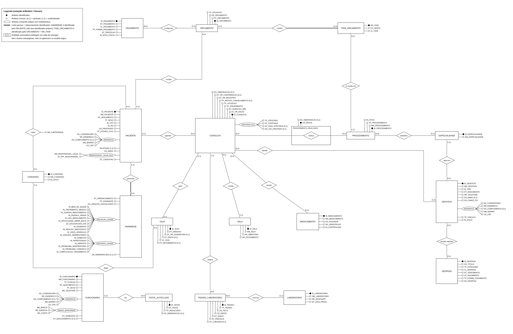

# Especificação do DER conceitual (para desenhar no brModelo)

> [`DER_conceitual.png`](DER_conceitual.png) é o diagrama da entrega, na notação do brModelo (Heuser); [`DER_conceitual.svg`](DER_conceitual.svg) é a mesma imagem em vetor, para ampliar sem perder qualidade. Este arquivo lista tudo o que está no diagrama e por quê.

## Resumo

- **18 entidades** (2 fracas: ANAMNESE e ITEM_ORCAMENTO) e **1 entidade associativa** (PROCEDIMENTO_REALIZADO);
- **18 relacionamentos** (R01–R18), todos binários, com (mín, máx) nos dois lados; 2 identificadores (R04, R09); 1 N:N (R13); nenhum autorrelacionamento;
- nenhuma generalização/especialização;
- atributos compostos: ENDERECO (PACIENTE, DENTISTA, FUNCIONARIO), DADOS_BANCARIOS (FUNCIONARIO), AVALIACAO_SAUDE e HISTORICO_SAUDE (os dois blocos da Ficha de Anamnese), RESPONSAVEL_LEGAL (0,1) (PACIENTE) e ATESTADO (0,1) (CONSULTA); multivalorado: TELEFONE (1,2) do PACIENTE; atributo de relacionamento: NR_CARTEIRINHA (R03);
- **sem chaves estrangeiras** (elas só aparecem no modelo lógico).

## O que mudou: de 35 para 26, depois 17 e, com a visita de retorno, 18 relacionamentos

| Versão | Entidades | Relacionamentos | Tabelas no lógico |
|---|---|---|---|
| Rascunho feito antes da entrevista (descartado) | 23 + 2 generalizações | 35 | 31 |
| 1ª versão a partir do levantamento | 22 | 26 | 25 |
| 2ª versão (redução) | 18 | 17 | 21 |
| **Esta versão** | **18** | **18** | **21** |

A 1ª versão ainda modelava como entidade o que, na clínica, **é só um dado de outra coisa**. O critério desta revisão foi: só é entidade o que tem dados próprios **e** é consultado por conta própria; só é relacionamento o que a clínica de fato registra ou o que uma regra do levantamento precisa conferir. Depois da redução, a visita de retorno (28 e 29/10/2026) mostrou que paciente já trocou de convênio e que o cadastro não guarda o antigo; por isso a ligação CONVENIO *paga* GUIA (R18) voltou: a guia precisa continuar no convênio que a emitiu.

| Saiu | Virou | Por quê (fato do levantamento) |
|---|---|---|
| Autorrelacionamento PACIENTE *é responsável por* PACIENTE | Atributo composto opcional RESPONSAVEL_LEGAL (0,1) em PACIENTE (nome e CPF) | Confirmado na visita de retorno: a recepcionista digita o nome e o CPF do responsável no cadastro do menor, e o sistema não liga a ficha da criança à do pai ou da mãe. O responsável pode ser qualquer adulto que acompanhe o menor, paciente ou não. |
| ORCAMENTO *é executado em* CONSULTA | — (sem ligação) | A clínica lança o pagamento no orçamento, não na consulta. A regra do pagamento antes do atendimento (RN07) é conferida por paciente, especialidade e data (auditoria A05), e a de que consulta de convênio não tem pagamento particular (RN09) passou para a auditoria A06. Custo: o dentista do orçamento só é deduzido pela especialidade dos itens, o que vale enquanto houver um dentista por especialidade. |
| CONVENIO *paga* GUIA | Saiu na 2ª versão e **voltou** (R18) | Na 2ª versão, o convênio da guia vinha do paciente. A visita de retorno mostrou que paciente já trocou de convênio e que o cadastro não guarda o antigo: sem a ligação, as guias antigas passariam para o convênio novo. O convênio da guia é um fato da emissão, não uma dependência transitiva. |
| RECEITUARIO + *prescreve* (2 relacionamentos) | R13 CONSULTA *receita* MEDICAMENTO (N:N) | A receita não tem número nem dado próprio: a data é a da consulta e o tipo (comum/controlada) vem do medicamento. |
| ATESTADO + *comprova* | Atributo composto opcional ATESTADO (0,1) em CONSULTA | O atestado é feito na ficha do paciente, ligado ao atendimento, e não tem número próprio. Confirmado na visita de retorno: no máximo um atestado por consulta e nunca sem atendimento; no de presença, a hora é a do agendamento; no de dias, a data pode ser posterior à consulta (o paciente esquece de pedir), por isso DT_ATESTADO. |
| RADIOGRAFIA + *solicita* | Procedimento do tipo RADIOGRAFIA em PROCEDIMENTO_REALIZADO | A radiografia é um procedimento feito numa consulta; a avaliação da Dra. vai em DS_OBSERVACAO (RN22) e fica com a data do exame (confirmado na visita de retorno). |
| PECA_PROTETICA + ENVIO_PECA (5 relacionamentos: moldagem, prova, laboratório, envios e custo) | PEDIDO_LABORATORIO com R14 e R15 | O que a clínica precisa saber é cada ida ao laboratório (pedido, previsão e chegada). A prova é um procedimento do tipo PROVA_PECA (auditoria A04); o custo do laboratório é uma despesa da categoria LABORATORIO (a clínica não quer custo por peça, só o total — visita de retorno). |

## Checklist da notação (esqueleto, seção 1.1)

- Entidade = retângulo; relacionamento = losango; cardinalidade (mín, máx) **nos dois lados**.
- Atributo = círculo ligado à entidade; **identificador = círculo preenchido**; atributo opcional com `(0,1)` ao lado do nome.
- Atributo composto = elipse com o nome, da qual saem os sub-atributos (ENDERECO, DADOS_BANCARIOS, AVALIACAO_SAUDE, HISTORICO_SAUDE, RESPONSAVEL_LEGAL (0,1), ATESTADO (0,1)); multivalorado = `TELEFONE (1,2)`.
- Entidade fraca (ANAMNESE, ITEM_ORCAMENTO): identificada pelo relacionamento, desenhado com **linha grossa** entre a entidade fraca e o losango (R04 e R09), como em Heuser. ANAMNESE é identificada só pelo PACIENTE; ITEM_ORCAMENTO, pelo ORCAMENTO + NR_ITEM (círculo preenchido).
- Atributo de **relacionamento**: NR_CARTEIRINHA, círculo ligado ao losango *cobre* (R03).
- Entidade associativa = retângulo envolvendo o losango *realiza*, com os atributos CD_DENTE (preenchido: compõe o identificador) e DS_OBSERVACAO (0,1).

**Convenção de leitura (brModelo/Heuser):** a cardinalidade escrita junto da entidade X diz com quantas ocorrências de X cada ocorrência da outra entidade se relaciona. Ex.: `PACIENTE (1,1) — agenda — (0,n) CONSULTA` = cada consulta tem exatamente um paciente; cada paciente tem de zero a várias consultas. É a mesma convenção do modelo lógico, então os dois diagramas não se contradizem.

## Entidades e atributos

Identificador marcado com **@**.

| Entidade | Tipo | Atributos | O que representa |
|---|---|---|---|
| ESPECIALIDADE | forte | **@ID_ESPECIALIDADE**, NM_ESPECIALIDADE | Área de atuação odontológica. Hoje é digitada livremente no cadastro do dentista; as 7 em uso viram um catálogo. |
| DENTISTA | forte | **@ID_DENTISTA**, NM_DENTISTA, ID_CRO, DT_NASCIMENTO, NR_TELEFONE, DS_EMAIL, DS_CHAVE_PIX, *ENDERECO* (composto: DS_LOGRADOURO, NR_ENDERECO, DS_COMPLEMENTO, NM_BAIRRO, CD_CEP), TP_VINCULO, IN_ATIVO | Profissional que atende os pacientes: 7 hoje, um por especialidade; 6 autônomos e a proprietária (HOF). |
| FUNCIONARIO | forte | **@ID_FUNCIONARIO**, NM_FUNCIONARIO, TP_FUNCAO, DT_NASCIMENTO, TP_SEXO, NR_TELEFONE, *ENDERECO* (composto: DS_LOGRADOURO, NR_ENDERECO, DS_COMPLEMENTO, NM_BAIRRO, CD_CEP), *DADOS_BANCARIOS* (composto: NM_BANCO, NR_AGENCIA, NR_CONTA), DT_ADMISSAO, DT_DESLIGAMENTO | Quem trabalha na clínica sem ser dentista: recepcionista, auxiliar de dentista e auxiliar de limpeza. |
| SALA | forte | **@ID_SALA**, NM_SALA, HR_ABERTURA, HR_FECHAMENTO | Consultório com uma cadeira. Sala 01 das 14h às 18h; Sala 02 das 8h às 18h. |
| CONVENIO | forte | **@ID_CONVENIO**, NM_CONVENIO, IN_ATIVO | Plano odontológico aceito pela clínica (5). A clínica só precisa do nome. |
| PACIENTE | forte | **@ID_PACIENTE**, NM_PACIENTE, DT_NASCIMENTO, TP_SEXO, ID_CPF, ID_RG, DS_PROFISSAO, TP_ESTADO_CIVIL, *ENDERECO* (composto: DS_LOGRADOURO, NR_ENDERECO, DS_COMPLEMENTO, NM_BAIRRO, CD_CEP), *TELEFONE (1,2)* (multivalorado), DS_EMAIL, *RESPONSAVEL_LEGAL (0,1)* (composto: NM_RESPONSAVEL_LEGAL, ID_CPF_RESPONSAVEL), DT_CADASTRO | Pessoa atendida, particular ou por convênio. Campos da Ficha de Anamnese (dados pessoais); do responsável legal do menor, guarda nome e CPF, como o sistema (atributo composto opcional). |
| ANAMNESE | fraca | DT_PREENCHIMENTO, TP_ASSINANTE, DS_ARQUIVO_DIGITALIZADO, *AVALIACAO_SAUDE* (composto: IN_BEM_DE_SAUDE, IN_TRATAMENTO_MEDICO, IN_ALERGIA_MEDICAMENTO, IN_DOENCA_GRAVE, IN_USA_MEDICAMENTO, IN_DIFICULDADE_ABRIR_BOCA, QT_ESCOVACOES_DIA, IN_DESMAIOS, IN_REACAO_ANESTESICO, IN_USOU_APARELHO), *HISTORICO_SAUDE* (composto: IN_GRAVIDA_AMAMENTANDO, IN_DIABETES, IN_HIPERTENSAO, IN_HEPATITE, IN_PROBLEMA_RESPIRATORIO, IN_PROBLEMA_CARDIACO, IN_COMPLICACAO_TRATAMENTO), DS_OBSERVACOES | Ficha de Anamnese do paciente (uma por paciente). Entidade fraca: identificada pelo paciente. |
| PROCEDIMENTO | forte | **@ID_PROCEDIMENTO**, NM_PROCEDIMENTO, TP_PROCEDIMENTO, IN_ATIVO | Catálogo de procedimentos (hoje digitados livremente). Inclui a radiografia, procedimento de apoio sem especialidade. |
| ORCAMENTO | forte | **@ID_ORCAMENTO**, DT_ORCAMENTO, DS_ORCAMENTO, TP_SITUACAO | Plano de tratamento com valores, feito pela Dra. responsável. Na ortodontia, um por mês. |
| ITEM_ORCAMENTO | fraca | **@NR_ITEM** (identificador parcial), CD_DENTE, VL_ITEM | Procedimento previsto no orçamento, com o dente e o valor. Entidade fraca de ORCAMENTO. |
| PAGAMENTO | forte | **@ID_PAGAMENTO**, DT_PAGAMENTO, VL_PAGAMENTO, TP_FORMA_PAGAMENTO, QT_PARCELAS, IN_NOTA_FISCAL | Pagamento particular, lançado dentro do orçamento; um orçamento pode ter mais de um. |
| CONSULTA | forte | **@ID_CONSULTA**, DT_HR_INICIO, QT_DURACAO_MIN, TP_ATENDIMENTO, TP_SITUACAO, TP_MOTIVO_CANCELAMENTO, DT_HR_REGISTRO, DT_HR_CONFIRMACAO, DS_OBSERVACAO, *ATESTADO (0,1)* (composto: TP_ATESTADO, DT_ATESTADO, QT_DIAS_ATESTADO, DS_CID_ATESTADO) | Agendamento e atendimento num só registro (decisão da E1). O atestado, quando emitido, é um atributo composto opcional da consulta. |
| GUIA | forte | **@ID_GUIA**, DT_EMISSAO, DT_HR_ASSINATURA, DT_ENVIO, VL_GUIA, DT_RECEBIMENTO | Guia de convênio da consulta: assinatura, valor, envio ao site do convênio e recebimento. Paciente e procedimentos vêm da consulta; o convênio é o da emissão (o paciente pode trocar de convênio). |
| MEDICAMENTO | forte | **@ID_MEDICAMENTO**, NM_MEDICAMENTO, DS_DOSAGEM, DS_ORIENTACAO, IN_CONTROLADO | Lista de medicamentos que já vem no sistema, com dosagem, orientação e indicação de controlado. |
| LABORATORIO | forte | **@ID_LABORATORIO**, NM_LABORATORIO, NR_WHATSAPP, QT_DIAS_PRAZO | Laboratório protético (2). Contato só pelo WhatsApp; prazo padrão de 7 dias. |
| PEDIDO_LABORATORIO | forte | **@ID_PEDIDO**, TP_PEDIDO, DS_PECA, CD_DENTE, DT_ENVIO, DT_PREVISTA, DT_CHEGADA | Cada ida de uma peça protética ao laboratório (confecção, ajuste, refinamento ou refazimento na garantia), pedida numa consulta. |
| TESTE_AUTOCLAVE | forte | **@ID_TESTE**, DT_TESTE, TP_RESULTADO, DS_OBSERVACAO | Teste biológico semanal da autoclave (hoje anotado em caderno). |
| DESPESA | forte | **@ID_DESPESA**, DS_TITULO, TP_CATEGORIA, VL_DESPESA, DT_VENCIMENTO, DT_PAGAMENTO, TP_FORMA_PAGAMENTO, DS_DESPESA | Conta a pagar lançada no financeiro (contas da clínica, insumos, salários, repasse, laboratório, imposto, Uber, correios). |

> ANAMNESE não tem identificador próprio: é identificada pelo PACIENTE (1:1). ITEM_ORCAMENTO tem identificador parcial (NR_ITEM), completado pelo identificador do ORCAMENTO.

## Entidade associativa

| Entidade associativa | Losango | Liga | Cardinalidades | Atributos (círculos ligados) | Por quê |
|---|---|---|---|---|---|
| PROCEDIMENTO_REALIZADO | realiza | CONSULTA — PROCEDIMENTO | junto de CONSULTA: (0,n) / junto de PROCEDIMENTO: (0,n) | CD_DENTE (identificador), DS_OBSERVACAO | Procedimento feito na consulta e o dente (na radiografia, a observação é a avaliação da Dra.). O mesmo procedimento pode ser feito em vários dentes na mesma consulta, por isso o dente compõe o identificador. |

## Relacionamentos

| Código | Entidade A | Card. junto de A | Losango | Card. junto de B | Entidade B | Atributos | Fato do levantamento |
|---|---|---|---|---|---|---|---|
| R01 | ESPECIALIDADE | (1,1) | atua em | (0,n) | DENTISTA | — | Uma especialidade por dentista; 7 dentistas, 7 especialidades. |
| R02 | ESPECIALIDADE | (0,1) | classifica | (0,n) | PROCEDIMENTO | — | Cada procedimento clínico é de uma especialidade; a radiografia, feita pela auxiliar para todas, não tem. |
| R03 | CONVENIO | (0,1) | cobre | (0,n) | PACIENTE | NR_CARTEIRINHA | Paciente de convênio tem nome do convênio e carteirinha; mais de um convênio nunca aconteceu. |
| R04 | PACIENTE | (1,1) | preenche (identificador) | (0,1) | ANAMNESE | — | Ficha preenchida e assinada na chegada do paciente novo; uma por paciente (relacionamento identificador). |
| R05 | PACIENTE | (1,1) | agenda | (0,n) | CONSULTA | — | O sistema exige paciente, dentista, dia e horário para salvar o agendamento (RN04). |
| R06 | DENTISTA | (1,1) | atende | (0,n) | CONSULTA | — | Idem (RN04). |
| R07 | SALA | (1,1) | recebe | (0,n) | CONSULTA | — | O sistema mostra em qual sala cada consulta acontece; 1 cadeira por sala. |
| R08 | PACIENTE | (1,1) | recebe | (0,n) | ORCAMENTO | — | O orçamento fica na ficha do paciente (aba Orçamentos). |
| R09 | ORCAMENTO | (1,1) | contém (identificador) | (1,n) | ITEM_ORCAMENTO | — | Orçamento traz procedimentos, dentes e valores; o total é a soma (relacionamento identificador). |
| R10 | PROCEDIMENTO | (1,1) | é orçado em | (0,n) | ITEM_ORCAMENTO | — | Cada item é um procedimento do catálogo. |
| R11 | ORCAMENTO | (1,1) | é pago por | (0,n) | PAGAMENTO | — | Pagamento lançado no orçamento; um orçamento pode ter mais de um pagamento. |
| R12 | CONSULTA | (1,1) | gera | (0,1) | GUIA | — | Uma guia por consulta de convênio (~72 guias para ~72 consultas por mês). |
| R13 | CONSULTA | (0,n) | receita | (0,n) | MEDICAMENTO | — | A receita é feita depois do atendimento com medicamentos da lista do sistema; não tem número nem dado próprio. |
| R14 | CONSULTA | (1,1) | origina | (0,n) | PEDIDO_LABORATORIO | — | A peça sai de uma moldagem (ou de uma prova que pede ajuste) feita numa consulta. |
| R15 | LABORATORIO | (1,1) | executa | (0,n) | PEDIDO_LABORATORIO | — | Cada pedido vai a um único laboratório (RN08). |
| R16 | DENTISTA | (0,1) | recebe repasse | (0,n) | DESPESA | — | O pagamento a cada dentista é lançado como despesa (repasse). |
| R17 | FUNCIONARIO | (1,1) | faz | (0,n) | TESTE_AUTOCLAVE | — | A auxiliar de dentista faz o teste biológico semanal e o anota. |
| R18 | CONVENIO | (1,1) | paga | (0,n) | GUIA | — | A guia é emitida no sistema de um convênio, que a paga. Paciente já trocou de convênio, e o cadastro não guarda o antigo: a guia antiga continua do convênio que a emitiu (visita de retorno). |

## O que ficou de fora do DER (e por quê)

| Item | Motivo |
|---|---|
| Estoque, compras e fornecedores de material | A clínica não controla estoque nem compras (nem no sistema, nem no papel); a necessidade de compra é vista olhando as salas. As compras aparecem só como despesa da categoria INSUMOS. |
| Tabela de preço e dados cadastrais do convênio (CNPJ, prazos, autorização, glosa) | A clínica só precisa do nome do convênio; guia recusada não acontece; a regra de pagamento é a mesma para os cinco convênios (RP04). |
| Agenda/escala semanal dos dentistas | Não há escala a cadastrar: a ortodontia atende de segunda a sexta na Sala 02, a HOF à tarde na Sala 01, e as outras especialidades vêm sob demanda, quando a Dra. libera a Sala 01 (visita de retorno). A agenda real fica na CONSULTA. |
| Quem agendou/alterou cada consulta | O sistema não registra; no banco, a autoria fica no log do SGBD (dicionário, seção 5), com um usuário por pessoa. |
| Ligação da despesa de laboratório com o pedido | Cada ida ao laboratório gera uma despesa (levantamento), lançada na categoria LABORATORIO com o número do pedido na descrição. A ligação por chave saiu porque a clínica não quer custo por peça, só o total das despesas com laboratório (confirmado na visita de retorno). |
| Caminho da imagem da radiografia | A imagem continua anexada à ficha do paciente no sistema, como hoje. Diferente da ficha de anamnese, cujo arquivo escaneado é o respaldo assinado exigido pela RP03, a radiografia não é documento assinado; o que a regra pede (RN22) é a avaliação, e ela fica no banco, com a data do exame. |
| Desconto e recibo | O desconto de 5% só existe quando o paciente pede nota fiscal: fica registrado pelo indicador IN_NOTA_FISCAL do pagamento, com o valor já descontado. Recibo só é dado a pedido e não é registrado. |
| Origem do paciente (indicação ou aplicativo do convênio) | Não é cadastrada e a clínica não usa a informação. |
| Nota fiscal | Emitida no sistema da prefeitura, fora do Simples Dental. |
| Ciclos da autoclave | Só o teste biológico semanal é anotado (caderno); os ciclos não têm registro. |
| Valor combinado do repasse | Combinado de boca a boca e não registrado; o que se registra é o pagamento (DESPESA). |

## Para redesenhar no brModelo (se for pedido o arquivo do brModelo)

Montando nesta ordem, o desenho fica igual ao do diagrama:

1. **Centro:** PACIENTE (esquerda) e CONSULTA (direita), ligados por *agenda* (R05).
2. **Faixa de cima:** PAGAMENTO — *é pago por* (R11) — ORCAMENTO — *contém* (R09, linha grossa até ITEM_ORCAMENTO) — ITEM_ORCAMENTO; ORCAMENTO desce até PACIENTE por *recebe* (R08).
3. **Direita do centro:** a entidade associativa PROCEDIMENTO_REALIZADO (retângulo em volta do losango *realiza*, com os círculos CD_DENTE, preenchido, e DS_OBSERVACAO), depois PROCEDIMENTO e ESPECIALIDADE (*classifica*, R02). ITEM_ORCAMENTO desce até PROCEDIMENTO por *é orçado em* (R10).
4. **Coluna da direita:** ESPECIALIDADE — *atua em* (R01) — DENTISTA — *recebe repasse* (R16) — DESPESA. CONSULTA liga a DENTISTA por *atende* (R06).
5. **Abaixo da CONSULTA:** GUIA (*gera*, R12) à esquerda, SALA (*recebe*, R07) à direita, MEDICAMENTO (*receita*, R13) e, mais abaixo, PEDIDO_LABORATORIO (*origina*, R14) — *executa* (R15) — LABORATORIO.
6. **Abaixo do PACIENTE:** ANAMNESE por *preenche* (R04), com a linha entre ANAMNESE e o losango em negrito.
7. **Canto inferior esquerdo:** FUNCIONARIO — *faz* (R17) — TESTE_AUTOCLAVE.
8. **Coluna da esquerda:** CONVENIO, mais à esquerda, na altura entre PACIENTE e ANAMNESE. Acima dela, *cobre* (R03, com o círculo NR_CARTEIRINHA) sobe e entra pelo topo do PACIENTE; abaixo, *paga* (R18) desce, passa abaixo da ANAMNESE e sobe até a GUIA.
9. Conferir as cardinalidades com a tabela de relacionamentos acima e exportar como `DER_conceitual.png`.
